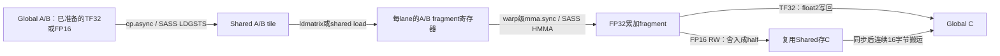

# Tensor Core 初体验：TF32、FP16 与 RTX 4090 D 实测

本章承接[第26章](26-vitamin-SIMT复现与K30公平对照.md)和[第27章](27-vitamin原入口复跑与寄存器上限实验.md)。本次真正运行了 Tensor Core：原生 CUDA 移植 vitamin-cuda 的四个 device kernel，分别对照同精度 cuBLAS，重新测量 K30 和严格 FP32 cuBLAS。**所有成绩只属于 RTX 4090 D，没有运行 RTX 3080。**

4096 上，两次实验都观察到作者实现相对同精度 cuBLAS 的小幅中位数优势；1024、2048 上 cuBLAS 更快。Tensor Core 结果不满足原始 FP32 的精度标准，因此不能称为“保持严格 FP32 精度的加速”。

## 1. 本次运行了什么

工具链重新确认：Windows 原生、RTX 4090 D 24564 MiB、驱动610.60、CUDA Toolkit12.4.131、MSVC19.37.32826.1、Ninja1.12.1、CMake3.31.6-msvc6、Windows SDK10.0.26100.0、Release/sm_89。运行时 `cublasGetVersion` 返回120405。WDDM、未锁频，未升级安装任何工具。

SGEMM HEAD为`545fb01a576ae38d84d00df6359e084eb14c94c2`，分支`results/rtx4090d-k30-stage2-20261021`；既有修改保持未提交。vitamin工作区仍干净，固定提交为`520f97093a2abc239977be83d244b327d0e2e2ef`。

| 实验名 | 原函数 | 输入 / 累加 / 输出 | CTA tile |
|---|---|---|---|
| `vitamin_tf32_single` | `sgemm_tf32_swizzle_bcf_kernel` | 显式量化TF32，float存储 / FP32 / FP32 | 128×128×16 |
| `vitamin_tf32_dbf` | `sgemm_tf32_swizzle_bcf_dbf_kernel` | 同上 | 128×128×16 |
| `vitamin_fp16_single` | `hgemm_bcf_kernel<...,half>` | FP16 / FP32 / FP16 | 128×128×32 |
| `vitamin_fp16_dbf_rw` | `hgemm_bcf_dbf_rw_kernel<...,half>` | 同上 | 128×128×32 |

原作者为QiLHong/vitamin-cuda。[来源清单](../../experiments/tensorcore/vendor/provenance.json)包含提交、路径、源文件与提取区间SHA256、行号；[许可证](../../experiments/tensorcore/vendor/LICENSE)完整保留。

- TF32来源：[固定提交源码](https://github.com/QiLHong/vitamin-cuda/blob/520f97093a2abc239977be83d244b327d0e2e2ef/kernels/sgemm/sgemm_tf32.cu)。
- FP16来源：[固定提交源码](https://github.com/QiLHong/vitamin-cuda/blob/520f97093a2abc239977be83d244b327d0e2e2ef/kernels/hgemm/hgemm.cu)。
- [提取脚本](../../scripts/extract_vitamin_tensor.py)在换行统一为LF后逐字保留device区间，仅替换头文件、加namespace、清理宏；`pack.cuh`和许可证按原字节复制。四核的tile、线程映射、同步和MMA算法均未改动。
- [独立CMake工程](../../experiments/tensorcore/CMakeLists.txt)不修改以前的target；实际编译命令包含`compute_89,sm_89`，不含`--use_fast_math`或忽略编译器检查的参数。

这是**原生移植实验**。没有运行本轮上游PyTorch入口，也没有复现作者的默认BF16入口、全部TF32变体或sm120/TMA实现。

## 2. 精度与输入契约先于性能

### 2.1 TF32不是完整的FP32乘法

TF32仍用32位寄存器承载数据，但有效尾数精度降低；本机使用CUDA的`nvcuda::wmma::__float_to_tf32`，其CUDA12.4实现生成`cvt.rna.tf32.f32`。上游这些kernel把输入位模式直接送入`mma...tf32`，没有显式转换。本入口在GPU准备阶段转换A/B，再把同一份转换结果交给作者核和cuBLAS。

这是一项**主机入口的数据契约适配**，不是原Python原始float输入协议的原封复跑。TF32转换规则与使用限制见[NVIDIA CUDA12.4编程指南](https://docs.nvidia.com/cuda/archive/12.4.1/cuda-c-programming-guide/index.html#alternate-floating-point)。本机量化结果以实际回读的float表示建立参考，不将其内存编码推广为所有未来架构的承诺。

FP16路线同样由原始A/B经`__float2half_rn`产生；作者核和cuBLAS使用完全相同的half输入与half输出。当前有界输入下，TF32与FP16展开为FP32后的数值指纹恰好相同，两个存储格式、K tile和输出精度仍不同。

### 2.2 cuBLAS配置

| 对照 | 配置 |
|---|---|
| 严格FP32 | `CUBLAS_PEDANTIC_MATH`、`CUBLAS_COMPUTE_32F_PEDANTIC` |
| TF32 | float输入/输出、`CUBLAS_COMPUTE_32F_FAST_TF32` |
| FP16 | half输入/输出、`CUBLAS_COMPUTE_32F`，FP32累加 |

Tensor handle设置`CUBLAS_MATH_DISALLOW_REDUCED_PRECISION_REDUCTION`，避免half输出下将归约降为half；所有handle禁用atomics，使用默认算法。见[cuBLAS文档](https://docs.nvidia.com/cuda/archive/12.4.1/cublas/index.html)。运行脚本只在子进程范围清除`NVIDIA_TF32_OVERRIDE=0`，结束后恢复；严格handle仍显式PEDANTIC。

### 2.3 四种参考分别回答不同问题

每次预检及轮末均保存以下比较：

1. `original_fp32`：原始未量化A/B的严格FP32结果。回答更换精度后的总误差。
2. `represented_input_strict_reference`：对实际量化后的A/B用PEDANTIC FP32计算；FP16路线再舍入到half输出。回答同一表示下的运算/累加差异。
3. `same_precision_cublas`：同输入、同输出类型的cuBLAS。回答作者实现与该库配置是否一致。
4. `represented_input_cpu_double`：独立CPU double计算实际表示的输入；FP16最后舍入到half。

小矩形`M=128,N=1024,K=32/64`全量检查131072个输出；大方阵每个实现检查256个固定位置。CPU double的大尺寸检查是抽样，不能描述为全量。

每种参考均记录max abs/max rel、相对L2误差、NaN/Inf、`abs<=0.01`、SIMT `atol=rtol=.001`、该精度的上游allclose。TF32上游eps为`.1`，HGEMM为`.016`；它们不是严格FP32的替代标准。max rel分母至少为1e-12，接近零时可能很大。

**实际结果：**全部作者核与各自同精度cuBLAS在已检查的完整输出上数值一致，max abs为0；NaN/Inf为0。同表示参考的上游精度判据与CPU double检查通过。相对原始FP32，三档大方阵的Tensor实现均未通过0.01、SIMT allclose，甚至相应eps的逐元素allclose也存在失败。

| 尺寸 | TF32相对原始FP32 max abs | FP16相对原始FP32 max abs | TF32相对L2 | FP16相对L2 |
|---|---:|---:|---:|---:|
| 1024 | 0.344391 | 0.499634 | 0.00035372 | 0.00040988 |
| 2048 | 0.503967 | 0.738647 | 0.00035471 | 0.00041067 |
| 4096 | 0.747345 | 1.142700 | 0.00035600 | 0.00041066 |

相对L2较小与逐元素allclose失败可以同时发生。输出接近零时，相对容差项很小，不能仅用总体平均误差宣布精度合格。FP16每个输出还要再次舍入，误差不能只归因于输入转换。

run01在2048预检停止：当时额外把TF32对量化输入参考的0.01作为退出条件，实测0.010620117导致作者核与cuBLAS同时失败。run02明确分离“低精度计算契约”和“FP32精度判定”，保留所有旧阈值及FAIL，只让符合低精度契约的实验继续计时；4096同表示TF32 max abs为0.030761719。失败样本和日志没有删除。

## 3. 测量方法与实测性能

全部`C=AB`，alpha1、beta0，沿用xorshift seed20261020和原有有界分布。输入指纹在每个`.meta.txt`中，实际A/B字节在每组实现间复用；FP16指纹记录展开后的float表示。两次4096实验的全部输入指纹已核对一致。

主实验run02：8实现×3尺寸×7轮×30次，共5040个原始CUDA events；每轮先预热10次。每一次预热/正式调用前，都在同一stream通过D2D从全零C0恢复C，复制在event之外。FP16复制的字节数为FP32的一半；这一跨精度差异及缓存影响不能被当作单因素算法提升。

每次event只包围一次GEMM调用；不包含分配、CPU校验、输入转换、D2H或C0恢复。报告七个“轮平均延迟”的中位数，再换算`2MNK/time`。保存全部慢样本。轮末检查最后一次输出，没有声称逐个event都进行数值回读。

主实验轮转精度组，单/双缓冲相邻且每轮交换先后；cuBLAS在该精度组尾部。此顺序局限通过后面的独立交换复测进一步检查。

| 实现 | 1024 TFLOPS | 2048 TFLOPS | 4096 TFLOPS |
|---|---:|---:|---:|
| K30，严格FP32 | 22.006 | 30.855 | 46.596 |
| cuBLAS，严格FP32 | 29.551 | 42.978 | 49.215 |
| TF32单缓冲 | 25.305 | 41.731 | 64.010 |
| TF32双缓冲 | 31.472 | 46.453 | 70.016 |
| cuBLAS TF32 | 35.664 | 51.643 | 68.000 |
| FP16单缓冲 | 45.491 | 84.660 | 131.671 |
| FP16双缓冲+RW | 61.255 | 99.291 | 148.034 |
| cuBLAS FP16 | 77.663 | 116.941 | 142.751 |

数据：[主统计](../../results/windows/20261021-tensorcore/analysis02/summary.csv)、[全部逐轮配对](../../results/windows/20261021-tensorcore/analysis02/pairs.csv)、[正确性汇总](../../results/windows/20261021-tensorcore/analysis02/correctness-summary.csv)。

双缓冲相对单缓冲的逐轮吞吐提升中位数：

| 对照 | 1024 | 2048 | 4096 | 正收益轮数 |
|---|---:|---:|---:|---|
| TF32 DBF / single | +24.31% | +9.43% | +10.14% | 每档7/7 |
| FP16 DBF+RW / single | +34.91% | +17.65% | +11.63% | 每档7/7 |

FP16这一对同时改变双缓冲和写回布局，不能把全部收益归因于双缓冲。TF32两版本也有不同launch bounds/编译器调度，性能归因须结合资源与机器码。

### 3.1 4096交换先后的独立复测

初测领先只有几个百分点，且存在cuBLAS固定组尾的位置偏差，因此追加`pair-confirm01`：只比较两组作者最终核/cuBLAS，每组相邻、每轮交换前后；仍为7轮、10预热、30events，共840个event。主表数据未替换。

| 精度 | 作者延迟中位ms | cuBLAS延迟中位ms | 作者TFLOPS | cuBLAS TFLOPS | 逐轮提升中位 | 作者获胜 |
|---|---:|---:|---:|---:|---:|---|
| TF32 | 1.922566 | 1.985776 | 71.487 | 69.212 | +3.288% | 5/7 |
| FP16 | 0.920921 | 0.936818 | 149.241 | 146.708 | +2.410% | 6/7 |

TF32逐轮提升范围−3.72%～+12.12%；FP16范围−1.70%～+6.25%。轮均值CV分别为TF32作者3.51%、库3.11%；FP16作者1.38%、库1.56%。按两列吞吐中位数计算，FP16提升为约1.73%，与“逐轮比值的中位数2.41%”是不同统计量。

[复测数据](../../results/windows/20261021-tensorcore/pair-analysis01/summary.csv)和[配对统计](../../results/windows/20261021-tensorcore/pair-analysis01/paired-summary.csv)支持“本会话、该尺寸和配置下有小幅中位数优势”，不支持每轮获胜、所有形状领先或跨机器稳定领先。没有进行cuBLASLt算法搜索，比较对象是记录下来的默认算法配置。

### 3.2 遥测与计时范围

主实验遥测168点，温度43～55℃，SM2490～2715MHz；168个实现窗口中81个有遥测点。复测64点，44～52℃，SM2520～2715MHz，28个窗口均有遥测点。显存时钟均观察到10251～10501MHz。窗口包含预热和校验；200ms采样不能确定每一个event期间的频率。

输入组合预处理（同时生成TF32、half和审计用half展开数组）的单次观测值为1024约0.5673ms、2048约0.2877ms、4096约1.6415ms。它未经独立预热，不能当作某一路生产转换成本，更不能把不含转换的GEMM主表称为端到端性能。

## 4. 从线程看到Tensor Core

建议依次打开[TF32提取源码](../../experiments/tensorcore/vendor/vitamin_tf32.cuh)、[FP16提取源码](../../experiments/tensorcore/vendor/vitamin_fp16.cuh)，先定位上表四个原函数名，再读`M16N8K8`与`M16N8K16_F16`宏。

### 4.1 一条MMA由整个warp协作

SIMT中的FFMA通常按线程理解标量乘加。这里32个lane共同执行：

```text
TF32: mma.sync.aligned.m16n8k8.row.col.f32.tf32.tf32.f32
FP16: mma.sync.aligned.m16n8k16.row.col.f32.f16.f16.f32
```

它们分别计算一个16×8输出片段，K方向覆盖8或16。每个lane保存其中4个FP32累加元素，32×4=128；不能理解为每个线程各算一个完整16×8矩阵。所有参与lane必须遵守warp级指令的协作要求，不能任意让部分lane跳过MMA。

### 4.2 CTA、warp、lane与输出公式

CTA有256线程、8个warp，负责128×128输出。`warp=tid/32`、`lane=tid%32`；`warp_m=warp/4`、`warp_n=warp%4`，因此warp按2×4排布，每warp负责64×32。

每warp在M方向分4个16行片段，在N方向分4个8列片段。令`mi,ni∈[0,3]`，累加寄存器`r∈[0,3]`：

```text
row = warp_m*64 + mi*16 + lane/4 + (r/2)*8
col = warp_n*32 + ni*8 + (lane%4)*2 + r%2
global_row = by*128 + row
global_col = bx*128 + col
```

每线程4×4×4=64个输出，256×64=16384，恰好等于128²。

warp0的示例（行集合与列集合取笛卡尔积，各64个输出）：

| lane | 行集合 | 列集合 |
|---|---|---|
| 0 | 0,8,16,24,32,40,48,56 | 0,1,8,9,16,17,24,25 |
| 1 | 0,8,16,24,32,40,48,56 | 2,3,10,11,18,19,26,27 |
| 2 | 0,8,16,24,32,40,48,56 | 4,5,12,13,20,21,28,29 |
| 31 | 7,15,23,31,39,47,55,63 | 6,7,14,15,22,23,30,31 |

[CPU枚举脚本](../../scripts/analyze_tensor_mapping.py)检查输出、global→shared搬运、FP16 RW写回以及实际网格。16384个输出覆盖一次，无重复、遗漏和越界；[完整映射CSV](../../results/windows/20261021-tensorcore/mapping/output-fragments.csv)可按warp/lane筛选。公式检查不能替代GPU数值检查。

### 4.3 数据搬运、swizzle与同步

TF32：A的CTA片段为128×16，B为16×128；每次16字节搬4个float。FP16：A为128×32，B为32×128；同样16字节搬8个half。两者单buffer都占16KiB，double buffer占32KiB。



`cp.async`走global→shared异步搬运，不需要让线程用普通通用寄存器长期托住这批global数据。A/B仍需要从shared装入MMA操作数寄存器；不能将“异步复制”误读为MMA直接读取global。

TF32 A列映射`col ^ (((row>>1)&3)<<2)`；FP16 A改为左移3位。B列映射为`col ^ ((row&7)<<3)`。写入与读出使用同一映射，改变的是shared物理位置，逻辑矩阵不变。TF32源码也使用`ldmatrix...b16`搬运A的位片段，`b16`描述搬运形式，实际乘法类型仍由`mma...tf32`决定；它不意味着A已变成half。

单buffer每个K tile：

```text
cp.async(A/B) -> commit -> wait_group0 -> CTA同步
读shared、做MMA -> CTA同步 -> 下一tile覆盖同一buffer
```

双buffer：

```text
序言：搬tile0到S0 -> commit/wait -> CTA同步
迭代i：
  发出tile(i+1)到另一个buffer的异步搬运
  用当前buffer做tile(i)的MMA
  wait_group0 -> CTA同步 -> 交换read/write编号
尾部：计算最后一个已就绪tile
```

`wait_group0`等待本线程提交的异步copy；`__syncthreads()`建立整个CTA的共享数据可见性，并保护旧buffer的读者。不能用其中一个无条件替代另一个。

FP16 DBF+RW最后把As/Bs存储区复用为Cs：先同步确保所有warp已读完A/B，再各线程把half累加结果写入swizzled Cs，再同步确保Cs完整，最后按每线程8个连续half搬回global。此时**最终搬运线程不一定是计算该元素的线程**，详见[写回映射](../../results/windows/20261021-tensorcore/mapping/fp16-rw-shared-to-global.csv)。

### 4.4 尺寸限制必须由入口守住

本实验保守支持`M%128=0,N%1024=0,K%32=0`，正数且各维不超过4096。原因包括完整CTA、完整K tile和固定宽8的grid swizzle。采用向上取整grid不会补上kernel内部不存在的边界保护；128/256等任意小方阵不能笼统认为安全。

入口已实际拒绝5种不支持形状，且拒绝发生在创建输出和CUDA调用之前；小矩形则保留8列CTA安全验证序言/尾部。

## 5. 确认真的使用Tensor Core

[SASS汇总](../../results/windows/20261021-tensorcore/analysis02/sass-summary.csv)显示：

- TF32两核：`HMMA.1688.F32.TF32`。
- FP16两核：`HMMA.16816.F32`。
- 四核都有`LDGSTS`和`LDSM`；K30使用FFMA，HMMA为0。
- ptxas与资源导出：TF32 single/dbf为126/127寄存器，FP16 single/dbf_rw为124/128；静态shared分别16/32KiB；全部零spill、零stack/local。

对2048/4096的K30、strict cuBLAS、TF32 DBF/cuBLAS、FP16 DBF_RW/cuBLAS共12次NCU采样均完成。profile-only入口在5次预热后使用`cudaProfilerStart/Stop`限定一个GEMM，禁止混入公平计时表。原始`.ncu-rep`与CSV都在[profile01](../../results/windows/20261021-tensorcore/profile01)。

4096的代表性硬件计数：

| 实现 | Tensor pipe active % | FP32 FMA pipe active % | occupancy % | eligible warp / SMSP active cycle | barrier stall warp / SMSP active cycle |
|---|---:|---:|---:|---:|---:|
| K30 | 0 | 72.37 | 16.63 | 1.36 | 0.06 |
| strict cuBLAS | 0 | 75.91 | 16.67 | 1.56 | 0.09 |
| TF32 DBF | 45.87 | 3.34 | 31.70 | 0.19 | 0.48 |
| cuBLAS TF32 | 49.09 | 3.31 | 16.66 | 0.17 | 0.01 |
| FP16 DBF_RW | 48.39 | 2.14 | 31.94 | 0.20 | 0.80 |
| cuBLAS FP16 | 48.77 | 0.86 | 16.47 | 0.17 | 0.16 |

数据证明Tensor计算路径被实际执行。stall列不是耗时百分比，Tensor pipe指标也不能直接解释为“还有一倍速度可挖”。单次profile与七轮未插桩测量状态不同；不能因某条pipe百分比高低就推导吞吐必然高低。NCU全部local sectors为0；shared wavefront/conflict等完整计数保存在[证据汇总](../../results/windows/20261021-tensorcore/evidence-audit01/ncu-selected.csv)及原始CSV。

### 5.1 最终机器码中的预取顺序

从真实回跳BRA识别循环，[pipeline.csv](../../results/windows/20261021-tensorcore/evidence-audit01/pipeline.csv)和同目录循环摘录记录：

| 循环 | LDGSTS条数 | HMMA条数 | 最后LDGSTS之后、DEPBAR等待之前的HMMA |
|---|---:|---:|---:|
| TF32 single | 4 | 32 | 0 |
| TF32 DBF | 4 | 32 | 28 |
| FP16 single | 4 | 32 | 0 |
| FP16 DBF_RW | 4 | 32 | 17 |

因此，双buffer机器码确实把异步搬运发射放在一批MMA之前，而单buffer先等待再算。这支持其具备重叠机会，仍不能只根据指令数量量化隐藏了多少延迟。编译器甚至把FP16的DEPBAR提前到部分MMA之后、剩余MMA之前，说明源码顺序不是最终调度的逐行复制。

## 6. 结论、局限与下一步

已验证：本机Tensor路线运行成功；同精度cuBLAS逐元素数值一致；大尺寸相对SIMT明显更快；两轮4096实验都出现相对默认cuBLAS的小幅中位数优势；双缓冲版本在主实验每档7/7轮胜过对应单buffer版本。

尚未验证：3080表现、BF16、sm120/TMA、默认Python入口、Sanitizer、所有矩形/尾块、其他seed/分布/动态范围、跨日稳定性、cuBLASLt最佳算法、单独转换开销和端到端性能。现有误差结果不支持将Tensor输出当作原严格FP32任务的等价替换。没有锁频或绕过WDDM权限；NCU使用安装目录内现有section文件完成采样。

下一项具体实验：**只修改TF32 DBF的`SWIZZLE_W`网格分组宽度8→4，保持tile、MMA、shared布局和精度不变，测试2048/4096的L2局部性与性能。** 先在CPU证明网格仍为双射，再交替测试。当前数据不足以断言它会提速；这是一个比同时更改tile、stage数、精度更容易归因的假设。

## 7. 文件与复跑

主要新增文件：

- [benchmark.cu](../../experiments/tensorcore/benchmark.cu)：输入契约、三种精度、八实现、公平events、四类参考、profile与交换顺序复测入口。
- [独立工程](../../experiments/tensorcore/CMakeLists.txt)及vendor来源/许可证：保留旧构建和kernel。
- [Build](../../scripts/windows/Build-TensorCore.ps1)、[Run](../../scripts/windows/Run-TensorCore.ps1)、[Profile](../../scripts/windows/Profile-TensorCore.ps1)：进程内工具链初始化、证据保存与禁止覆盖。
- [提取](../../scripts/extract_vitamin_tensor.py)、[映射](../../scripts/analyze_tensor_mapping.py)、[统计](../../scripts/summarize_tensor_results.py)、[证据审计](../../scripts/audit_tensor_evidence.py)：复核代码、线程覆盖、原始event、历史文件和SASS。

所有结果在`results/windows/20261021-tensorcore/`，旧373个源码/脚本文件和845个历史结果文件的SHA均未变。build03与build04的所有device指令列表相同，build04只增加主机侧交换先后选择器；run02/profile01绑定build03，pair-confirm01绑定build04。二进制、编译命令、源码快照分别保存在对应build目录。build01缺失mma头/namespace的失败日志和run01精度停止记录保留。

在PowerShell 7中执行；所有输出目录必须是新目录：

```powershell
Set-Location D:\CUDA-Lab\cuda-learning\SGEMM_CUDA
$tag = Get-Date -Format 'yyyyMMdd-HHmmss'
$out = "results\windows\$tag-rtx4090d-tensorcore"

.\scripts\windows\Build-TensorCore.ps1 -EvidenceDir "$out\build"
.\scripts\windows\Run-TensorCore.ps1 -OutputDir "$out\run"
.\scripts\windows\Run-TensorCore.ps1 -OutputDir "$out\pairs" -PairsOnly
.\scripts\windows\Profile-TensorCore.ps1 -OutputDir "$out\profile"

& 'D:\Anaconda\Anaconda\python.exe' .\scripts\summarize_tensor_results.py `
  --run "$out\run" --build "$out\build" --profile "$out\profile" --output "$out\analysis"
& 'D:\Anaconda\Anaconda\python.exe' .\scripts\summarize_tensor_results.py `
  --run "$out\pairs" --build "$out\build" --output "$out\pair-analysis"
& 'D:\Anaconda\Anaconda\python.exe' .\scripts\analyze_tensor_mapping.py --output "$out\mapping"
& 'D:\Anaconda\Anaconda\python.exe' .\scripts\extract_vitamin_tensor.py --verify
```

重新核验本次固定归档（输出也需新目录）：

```powershell
& 'D:\Anaconda\Anaconda\python.exe' .\scripts\audit_tensor_evidence.py `
  --root .\results\windows\20261021-tensorcore `
  --output ".\results\windows\20261021-tensorcore\audit-$tag" `
  --telemetry-offset-minutes 480
```

本轮没有自动提交、推送或合并。

## 8. 五道自检题

1. 一条`m16n8k8`为什么每lane需要4个累加寄存器，而不是128个？
2. 根据公式列出warp5、lane2在`mi=1,ni=3`时拥有的4个输出坐标。
3. 为什么`cp.async.wait_group 0`之后仍然需要CTA同步？最后复用shared存C时又要保护哪些读写？
4. 作者核与同精度cuBLAS完全一致，为什么仍可能不通过对原始FP32的0.01标准？
5. 如果把转换加回端到端时间，或把cuBLAS放到每对的前面，哪一类性能结论可能改变？应保存哪些数据才能判断？
