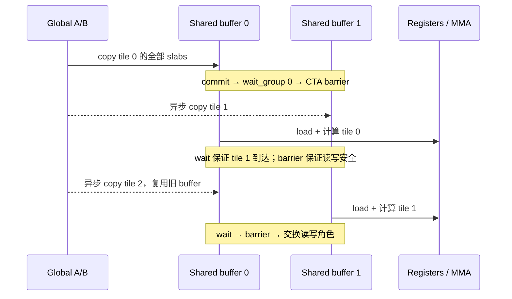

# 30. Tensor Core 的 K 分块：同步减少了，为什么大矩阵反而变慢？

> 阅读衔接：本章解释 BK32 的资源代价；末尾提出的 BN64 假设后来已在[第 31 章](31-TensorCore-BN64优化与尺寸效应.md)实现。入门原理见[微教材第 9 章](微教材/09-TensorCore从SIMT到矩阵指令.md)，两轮实验串讲见[第 32 章](32-RTX4090D-TensorCore优化学习指南.md)。本文的前置源码哈希与“尚未提交”都是实验时点记录；冻结归档不随文档维护重写。

本轮已在 Windows 原生 RTX 4090 D 上完成编译、映射枚举、数值检查、两批七轮计时与 12 次 NCU。
将 TF32 双缓冲的 BK 从16增加到32，1024 的独立配对吞吐中位数提高 **2.09%**，
2048、4096 则分别下降 **4.75%、6.45%**。三个尺寸的 BK32 都未超过本轮 TF32 cuBLAS。
保留候选作为尺寸相关的学习实验，原版仍保留，不替换项目默认实现。

这是基于作者思路编写的优化版本，不是直接将原源码换个名字运行。
本轮不改变 TF32 精度，也没有宣称它是严格 FP32 SGEMM 的等精度加速。

## 30.1 来源、保护与实验假设

上游 QiLHong / vitamin-cuda：提交 `520f97093a2abc239977be83d244b327d0e2e2ef`，
文件 `kernels/sgemm/sgemm_tf32.cu`，原函数 `sgemm_tf32_swizzle_bcf_dbf_kernel`。
署名和[许可证](../../experiments/tensorcore/vendor/LICENSE)保留。
本地 SGEMM 起点为 `b718c7bfe3577822e3335b215e386d2c57c420eb`，
分支 `results/rtx4090d-k30-stage2-20261021`。

实验前假设：原版每推进16个 K 元素就执行一次循环及同步；将 BK 增至32，
可能通过减少循环控制、commit/wait 和 CTA barrier 次数提高性能。
代价预先明确：双缓冲 shared 翻倍，循环展开可能增加寄存器和降低驻留 CTA 数。
**BM/BN 不变，因此完整 GEMM 的 A/B 理论搬运总量没有减少；不能称为提高了全局访存复用率。**

三条自定义实现和 cuBLAS 一起比较：

| 名称 | BK | shared 形式 | 用户 shared/CTA | 用途 |
|---|---:|---|---:|---|
| `vitamin_tf32_dbf` | 16 | 原版静态 | 32 KiB | 保留作者基线 |
| `tf32_dynamic_bk16` | 16 | 动态、一个 slab | 32 KiB | 控制动态 shared 适配差异 |
| `tf32_dynamic_bk32` | 32 | 动态、两个 slab | 64 KiB | 本次候选 |
| `cublas_tf32` | 库内部选择 | 库内部选择 | 见 NCU | 相同 TF32 输入对照 |

W8 网格排列、128×128 输出 tile、256线程、warp 输出归属、swizzle、双缓冲协议、
MMA 的 K 累加顺序均保持。没有叠加上一轮 W1 优化，没有加入寄存器上限参数。
完整源码差异见 [device.diff](../../experiments/tensorcore-ktile/device.diff)、
[host-harness.diff](../../experiments/tensorcore-ktile/host-harness.diff) 和
[provenance.json](../../experiments/tensorcore-ktile/provenance.json)。

最终哈希审计：实验前408个源码/脚本等文件、1364个历史归档文件均未改变。
vitamin 仓库未改动；本轮没有自动提交、推送、安装或升级环境。

## 30.2 为什么不能只把 BK 常量改成32

顺着 [tf32_ktile.cuh](../../experiments/tensorcore-ktile/tf32_ktile.cuh) 阅读：
原版搬运每线程四次16字节，仅覆盖 A[128][16] 和 B[16][128]。
计算循环也只有两个 `m16n8k8` K 步。只改模板会出现未加载数据或漏算。
直接把 A 改成 `[128][32]` 又会改变行跨度及 bank 映射，不再是干净的 K 分块对照。

候选采用 `Slices=BK/16`：

```cpp
As[2][Slices][128][16]; // buffer, slab, row, swizzled_col
Bs[2][Slices][16][128];
```

这些数组由同一块动态 shared 分区得到，地址16字节对齐。
Bs 的起点是 `2*Slices*128*16*sizeof(float)` 字节。
每个 slab 都保持原来的行跨度和 XOR 公式：

```text
A shared_col = col XOR (((row >> 1) & 3) << 2)
B shared_col = col XOR ((row & 7) << 3)
```

每个 slab 为2048个 float，偏移是32个 bank 的整数倍。
CPU 脚本验证了所有字地址以及相对 bank 号；这证明布局性质，不能替代硬件 wavefront/conflict 采样。
BK32 需要64 KiB动态 shared，入口用 `cudaFuncSetAttribute` 为这个函数开启 opt-in，
它是进程内 CUDA 函数属性，不涉及系统设置或管理员权限。

## 30.3 一个线程到底负责哪些元素

`warp=tid/32`，`lane=tid%32`；8个 warp 排成2×4，每个 warp 负责64×32输出。
`mi,ni=0..3`，`r=0..3` 表示一个 m16n8 fragment 的四个累加寄存器：

```text
row = by*128 + (warp/4)*64 + mi*16 + lane/4 + (r/2)*8
col = bx*128 + (warp%4)*32 + ni*8 + (lane%4)*2 + r%2
```

每线程4×4个 fragment，每个fragment持有4个结果，共64个输出；256×64=16384。
例如 warp0、mi=ni=0，以下坐标均相对 CTA：

| lane | 四个输出坐标 |
|---:|---|
| 0 | (0,0)、(0,1)、(8,0)、(8,1) |
| 1 | (0,2)、(0,3)、(8,2)、(8,3) |
| 2 | (0,4)、(0,5)、(8,4)、(8,5) |
| 31 | (7,6)、(7,7)、(15,6)、(15,7) |

其余 fragment 在这些坐标上加 `(16*mi,8*ni)`。BK 只改变累加的推进方式，不改变这些归属。
`mapping01/original-mapping/output-fragments.csv` 枚举完整 CTA，重复、遗漏、越界均为0。

协作搬运与输出归属不是同一个映射。对每个 slab `s`：

```text
A: row=tid/4 或 tid/4+64；K列=tileK+s*16+(tid%4)*4+e
B: K行=tileK+s*16+tid/32 或再加8；col=(tid%32)*4+e
e=0..3
```

例如 tid0 在第二个 slab 搬 A 的行0/64、K列16..19，搬 B 的 K行16/24、列0..3。
BK16 每线程4次 cp.async，BK32 每线程8次。CPU 枚举同时验证两个 buffer，
BK16 的8192、BK32的16384个 shared float 地址恰好覆盖一次，没有 A/B 或 buffer 间别名。
详见 `mapping01/copy-addresses.csv`。

## 30.4 数据流和同步协议

本核 A/B 数据流是 **global → shared → register → Tensor Core accumulator**。
`cp.async` 绕过显式中间数据寄存器；地址计算仍会使用寄存器。
A 通过 `ldmatrix.x4.b16` 搬运 float 位模式，B 通过 shared load 读入寄存器，
`mma.sync.aligned.m16n8k8.row.col.f32.tf32.tf32.f32` 累加到 FP32 `sum[4][4][4]`。
最终用原来的 FLOAT2 写回 C，不增加 epilogue kernel。

BK32 的 `k_step=0..3`，`slab=k_step/2`，`k_offset=(k_step%2)*8`，
因此四步仍按 K=0..7、8..15、16..23、24..31 的顺序累加。
CPU 枚举 K=32、64、96、1024、2048、4096 后，确认与原版的8宽步序列完全相同。



首个 wait/barrier 保证消费者看到首 tile。主循环的 wait 等待本线程异步复制，
CTA barrier 使全 CTA 的生产者与消费者协调，并保证旧 buffer 在下一轮覆盖前已读完。
两块 buffer 让“写下一 tile”和“读当前 tile”使用不同地址，但不能因此删除同步。
末尾独立计算最后已加载的 tile，不再预取越界 tile。

每 CTA 的动态 barrier 次数是 `K/BK`：例如4096为256→128。
这不等于 barrier stall 或总耗时必然减半，因为等待时间还受线程进度、访存和调度影响。
BK32 的 shared 和寄存器同时变化，本轮不能精确量化“多少收益只来自同步减少”。

## 30.5 构建、数值和公平计时

实际环境：RTX4090D 24GB、114 SM、WDDM、驱动610.60；CUDA12.4.131、cuBLAS120405；
MSVC19.37.32826.1、Windows SDK10.0.26100.0、CMake3.31.6、Ninja1.12.1。
复用已有工具，没有安装。独立 Release 目录为 `build-windows-tensor-ktile-sm89`。
真实编译命令含 `--generate-code=arch=compute_89,code=[compute_89,sm_89]`、`-O3`、`-lineinfo`，
不含 `--use_fast_math` 或忽略编译器检查参数。记录位于 `build01/compile_commands.json`、`build.log`。

主表 C=AB，alpha=1、beta=0；seed=20261020，同一原始输入显式转换为 TF32。
每个实现使用完全相同的输入字节，FNV1a64 指纹已比较相等。
转换、分配、参考计算均在计时外；cuBLAS 明确使用 `CUBLAS_COMPUTE_32F_FAST_TF32`，
并禁止 reduced-precision reduction。PEDANTIC FP32 只作为数值参考，本轮不计时。

每批每尺寸7轮，每轮每实现预热10次、计时30次；一次调用一个 CUDA event 结果。
每次调用前同一 stream 上 D2D 恢复全零 C0，在 event 之外。
所有被测实现都恢复4字节/元素；该策略仍会扰动缓存，并非完全冷缓存基准。
`run01` 四实现2520 events；独立 `confirm01` 三实现1890 events，共4410正式 events，全部保留。
小尺寸检查另有24个 event，不混入正式表。慢样本没有删除。

验证顺序：128×1024、K=32/64/96，之后三种方阵；小矩形 CPU double 检查全量131072输出，
大方阵每次检查固定256个位置。GPU 参考和原版逐位比较均覆盖全量输出。
六种不合法形状在主机入口被拒绝，包括 K=48，未启动不受支持的尾块 kernel。

两批共156次自定义实现与原版全量逐位比较，零差异；864行参考检查均无 NaN/Inf。
对于本批输入，三个自定义实现与相同精度 cuBLAS 的最大绝对误差也为0。
但以下误差标准仍分别报告：

| N | 相对原始 FP32 最大绝对误差 | 相对已量化输入 PEDANTIC 参考 | 已量化输入 CPU double（256点） |
|---:|---:|---:|---:|
| 1024 | 0.344390869 | 0.003845215 | 0.001506060 |
| 2048 | 0.503967285 | 0.010620117 | 0.005481268 |
| 4096 | 0.747344971 | 0.030761719 | 0.013537469 |

相对原始 FP32，绝对误差≤0.01、原 SIMT allclose 均失败；TF32阈值也不是原始精度保证。
相对已量化输入，原 TF32 allclose 标准通过，但2048/4096的全量绝对0.01及SIMT标准仍有失败；
4096 CPU抽样也有10点超过绝对0.01。所有失败计数、最大相对误差保留在 `*.checks.csv` 与 `errors.csv`。
近零结果会放大最大相对误差，不能只看单一最大相对值。
沿用 harness 的精确表达式为 `abs(got-ref) <= atol + rtol*abs(got)`，
SIMT 为 atol=rtol=.001，TF32为 .1；未改阈值或参数方向。
**Sanitizer 本轮未运行，仍为未验证；逐位一致与 CPU 枚举不能代替 race/memory 检查。**

## 30.6 实测结果：报告独立复测，不挑选最好的一轮

吞吐单位 TFLOPS，由“每轮30个 event 的均值延迟，再取七轮中位数”换算。

| N | 初测原版 | 动态 BK16控制 | 初测 BK32 | 初测 cuBLAS |
|---:|---:|---:|---:|---:|
| 1024 | 31.456 | 31.410 | 32.083 | 35.206 |
| 2048 | 48.541 | 48.541 | 46.192 | 51.909 |
| 4096 | 71.562 | 71.468 | 66.958 | 69.140 |

初测中 BK32 相对动态 BK16 的逐轮配对中位数为 +2.30%、−4.83%、−6.42%。
动态 BK16 和静态原版表现接近；不能把百分之几的大尺寸回退归结为动态 shared 接口本身。

| N | 复测原版 | 复测 BK32 | 复测 cuBLAS | BK32/原版配对提升中位数 | 七轮范围 | 胜出轮数 |
|---:|---:|---:|---:|---:|---|---:|
| 1024 | 31.332 | 32.063 | 35.605 | +2.09% | +1.61%..+6.78% | 7/7 |
| 2048 | 48.461 | 46.155 | 51.904 | −4.75% | −4.86%..−4.58% | 0/7 |
| 4096 | 71.553 | 66.967 | 69.216 | −6.45% | −6.90%..−6.02% | 0/7 |

| N | 原版中位延迟 / 轮均值CV | BK32中位延迟 / CV | cuBLAS中位延迟 / CV |
|---:|---:|---:|---:|
| 1024 | 0.068540ms / 1.82% | 0.066976ms / 0.30% | 0.060314ms / 0.40% |
| 2048 | 0.354509ms / 0.10% | 0.372224ms / 0.04% | 0.330991ms / 0.60% |
| 4096 | 1.920790ms / 2.78% | 2.052334ms / 2.77% | 1.985639ms / 0.24% |

4096第0轮原版和候选都偏慢：分别2.062816ms和2.204944ms，原始数据保留。
原版相对 cuBLAS 的配对中位数 +3.31%，但只有6/7轮胜出；不能称每轮都超过 cuBLAS。
BK32 相对 cuBLAS 三个尺寸的配对中位数为 −9.91%、−11.07%、−3.24%。

两批遥测分别84/65点，约200ms间隔；初测43..53°C、复测44..53°C，
SM时钟2520..2715MHz，显存10251..10501MHz。未锁频，WDDM与桌面负载可能影响样本。
`*.windows.csv` 保存每轮UTC窗口；遥测稀疏且包含检查间隙，不冒充每个 event 的温度/时钟。
这是两个短批次中的稳定方向，不代表跨日期、任意输入和所有形状的统计保证。

## 30.7 NCU 与最终 SASS 给了什么证据

NCU2024.1.1 成功采集3尺寸×4实现，共12个 launch，原始 `.ncu-rep` 与 CSV 都保留。
使用 kernel replay、`--clock-control none --cache-control none`。
安装目录内置 sections 可用；Documents sections 写入警告保留，没有修改 HOME 或绕过权限。
每项仅一次 profile，NCU时间与公平 event 表严格分离。

### 资源限制

| 项目 | 原版 BK16 | 动态 BK16 | 动态 BK32 |
|---|---:|---:|---:|
| ptxas registers/thread | 127 | 127 | 170 |
| ptxas spill load/store、stack | 0 | 0 | 0 |
| 用户 shared/CTA | 32768B | 32768B | 65536B |
| NCU shared/CTA（含driver 1024B） | 33792B | 33792B | 66560B |
| CUDA occupancy API：CTA/SM | 2 | 2 | 1 |
| NCU寄存器限制：CTA/SM | 2 | 2 | 1 |
| NCU shared限制：CTA/SM | 3 | 3 | 1 |

NCU采集的 shared 配置为102400B/SM，设备单CTA opt-in 上限101376B。
即使只减少 BK32 的寄存器，两个64KiB buffer集合也放不进一个SM；
**仅设置 maxrregcount 不能恢复两个 CTA，且可能引入 spill。**
NCU local load/store sectors也都是0。

### 活跃程度与等待

下表为原版→BK32；stall/eligible 的单位是每个调度器活跃周期的平均 warp 数，不是耗时百分比。

| N | achieved occupancy | eligible warps | Tensor管线活跃度 | issue active | barrier stall | short scoreboard | long scoreboard |
|---:|---|---|---|---|---|---|---|
| 1024 | 16.59→16.58% | .13→.11 | 40.87→41.92% | 9.20→7.39% | .11→.18 | .20→.00 | .03→.02 |
| 2048 | 27.37→16.61% | .17→.11 | 44.24→42.30% | 9.79→7.27% | .37→.18 | .24→.00 | .03→.01 |
| 4096 | 31.70→16.65% | .19→.11 | 45.87→42.93% | 10.03→7.29% | .48→.19 | .25→.00 | .03→.01 |

1024只有64个CTA，少于114个SM，原版两个CTA的理论驻留能力难以发挥；
BK32的资源代价没有在 achieved occupancy 上体现为下降，小幅收益与控制开销摊薄相符。
注意此尺寸 barrier stall 反而增加，不能把 +2.09% 简化成“barrier 等待下降”。
2048/4096有256/1024个CTA，BK32驻留容量减半开始影响更多任务，
eligible和Tensor管线活跃度下降与计时回退方向一致。
这些是支持解释的相关证据，不是把4.75%/6.45%逐项分解的因果测量。

4096 shared-load wavefront：原版100758493，BK32为100663296；
原版 shared-load conflict92449，BK32为0，均无 shared-store conflict。
2048相应 load conflict 为6138→0。CPU布局 bank 映射不变，但编译调度和并发不同，
不能把少量冲突消失归功于“修复了 swizzle”；冲突数量本来只占 wavefront 的很小部分。
异步拷贝不计入这里的普通 LSU shared-store wavefront，0不表示没有写 shared。
4096 L2命中94.72→94.92%，DRAM读364090368→355713152B；仍不足以抵消回退。
FP32 FMA管线活跃度3.34→1.70%，这不是Tensor乘加吞吐，主计算应看 HMMA/Tensor指标。

### 源码顺序与机器码顺序

原版 SASS 与前轮保存的作者基线完全相同；动态BK16和原版 K 主循环均111条指令。

| 主循环静态计数 | 原版/动态BK16 | BK32 |
|---|---:|---:|
| SASS 指令数 | 111 | 172 |
| LDGSTS | 4 | 8 |
| HMMA | 32 | 64 |
| 最后LDGSTS与完成等待之间的HMMA | 28 | 40 |

BK32循环范围 `0xe80..0x1930`，最后copy在`0x1120`，完成等待`DEPBAR.LE`在`0x1790`，
CTA barrier在`0x1920`。等待前40条HMMA，等待后还有24条HMMA，再barrier。
原版最后copy`0xfe0`、wait`0x14b0`，等待前28条HMMA、后4条。
这说明编译器没有逐字遵守源码“全部MMA再wait”的排列；只要数据依赖安全，它可以重排。
`LDGDEPBAR` 是提交相关指令，不能用字符串包含DEPBAR误当完成等待。
本轮确实有 copy与计算交错的机器码证据，但无法据此保证访存延迟被完全隐藏。
全函数静态BAR数量仍是2（序言和循环各一处），动态执行次数则随K/BK变化；不要混淆两者。

## 30.8 下一次怎样复跑

在 PowerShell 执行以下命令；所有输出使用新时间戳目录，不覆盖本次证据。
构建脚本会在自己的进程内初始化既有MSVC/CUDA，调用者无需预先运行 Developer Prompt。

```powershell
Set-Location 'D:\CUDA-Lab\cuda-learning\SGEMM_CUDA'
$ps7 = 'C:\Users\Administrator\.cache\codex-runtimes\codex-primary-runtime\dependencies\native\powershell\pwsh.exe'
$py = 'D:\Anaconda\Anaconda\python.exe'
$stamp = Get-Date -Format 'yyyyMMdd-HHmmss'
$out = "results\windows\tensorcore-ktile-rerun-$stamp"

& $ps7 -NoProfile -File scripts\windows\Build-TensorKTile.ps1 -EvidenceDir "$out\build"
if ($LASTEXITCODE) { throw 'build failed' }
& $py scripts\analyze_tensor_ktile_mapping.py --output "$out\mapping"
if ($LASTEXITCODE) { throw 'mapping failed' }
& $ps7 -NoProfile -File scripts\windows\Run-TensorKTile.ps1 -OutputDir "$out\run" -Selection all
if ($LASTEXITCODE) { throw 'run failed' }
& $ps7 -NoProfile -File scripts\windows\Run-TensorKTile.ps1 -OutputDir "$out\confirm" -Selection confirm
if ($LASTEXITCODE) { throw 'confirmation failed' }
& $ps7 -NoProfile -File scripts\windows\Profile-TensorKTile.ps1 -OutputDir "$out\profile"
if ($LASTEXITCODE) { throw 'profile failed; raw evidence retained' }
& $py scripts\summarize_tensor_ktile.py --run "$out\run" --output "$out\analysis"
& $py scripts\summarize_tensor_ktile.py --run "$out\confirm" --profile "$out\profile" --output "$out\confirm-analysis"
```

核验本次冻结证据可运行（输出目录同样必须新建）：

```powershell
& $py scripts\audit_tensor_ktile.py --archive results\windows\20261021-tensorcore-ktile --output "$out\saved-evidence-audit"
```

该审计还会比较当前源码与本轮前置快照；未来主动修改旧源码后失败是预期的保护行为。
阅读顺序：本章 → `tf32_ktile.cuh` → `device.diff` → `confirm-analysis02/paired-rounds.csv`
→ `evidence03/*main-loop.sass.txt` 和 `ncu-selected.csv`。

## 30.9 下一项具体假设与练习

下一项值得单独验证：**BK32保留，BN从128缩到64，重新设计warp/fragment覆盖，
将双缓冲用户shared降至48KiB，争取每SM驻留两个CTA。**
公式为 `2*(128*32+32*64)*4=49152B`；含当前driver开销，两个CTA约100352B，
在已测102400B shared配置内。还必须把寄存器预算控制到允许两个CTA，并枚举新映射。
代价是CTA数、A重复加载量、网格尾波等也变化；它是新tile方案，不能宣称单因素纯occupancy实验。
本轮当时尚未实现或测量这个方案；后续[第31章](31-TensorCore-BN64优化与尺寸效应.md)已完成，2048获得稳定提升，4096没有稳定优于原版。

1. 为什么 BK32 减少了 barrier 次数，却没有减少完整 GEMM 的理论 A/B 搬运量？
2. 对 tid31、slab1，手算其 A/B 两次16B搬运的逻辑坐标和 shared 地址。
3. 若删除主循环末尾的 `__syncthreads()`，仅保留本线程的 `wait_group 0`，哪两类跨线程竞争仍可能发生？
4. 已知64KiB shared/CTA和100KiB/SM，为什么把寄存器170降到128仍无法使BK32驻留两个CTA？
5. SASS中“40条HMMA位于最后copy与wait之间”能证明什么、不能证明什么？为何不能将NCU的stall数直接换算为加速百分比？
