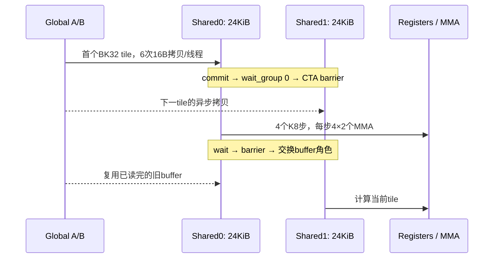

# 31. 将 BN 缩到64：2048提速，4096为什么没有继续提高？

> 后续进展（2026-10-22）：本章保留当时实验的参数、数据与局限。多 seed 稳健性验证见[第 33 章](33-TensorCore-BN64稳健性与尺寸适用范围.md)，官方 CUTLASS 对照及其精度失败见[第 34 章](34-CUTLASS与BN64的4090D公平对照.md)。后续批次不填入本章旧表；这里的“本轮”“下一步”按本章实验日期理解。

> 阅读衔接：先看[微教材第 9 章](微教材/09-TensorCore从SIMT到矩阵指令.md)的矩阵指令与精度，再用[第 32 章](32-RTX4090D-TensorCore优化学习指南.md)手算 BN64 的线程归属。本文保存该轮实验事实；BK32 和 BN64 后来已发布为 `3dc95f3`、`989105e`，实验起点和冻结源码快照继续保留原值。

本轮实际实现并测试 **BM128 / BN64 / BK32**。在 RTX4090D Windows 原生环境下，
独立七轮确认的2048性能为 **57.998 TFLOPS**，相对作者原版配对中位数提高 **19.56%**，
相对本轮相同输入的 TF32 cuBLAS 提高 **11.57%**，均7/7轮领先。
1024比原版快4.11%，仍不及库；4096与原版接近，配对中位数为−0.43%，2/7轮胜出。

结论限于本机、本输入、这些尺寸和计时协议。没有用降低精度解释本轮收益：
原版、父版本、新版与对照cuBLAS均使用同一份显式TF32输入、FP32累加和输出。
但它们相对原始严格FP32的误差标准仍失败，不能当作严格FP32替代。

## 31.1 假设与来源

[第30章](30-TensorCore-K分块实验与资源代价.md)已发现，单纯把BK增至32需要64KiB shared，
同时使用170寄存器，只有1CTA/SM。新假设是将BN128缩到64，
降低累加器和shared用量，争取2CTA/SM，同时让工作切成更多较小CTA，改善任务分布。

原作者：QiLHong / vitamin-cuda，提交 `520f97093a2abc239977be83d244b327d0e2e2ef`，
文件 `kernels/sgemm/sgemm_tf32.cu`，函数名 `sgemm_tf32_swizzle_bcf_dbf_kernel`。
本轮父版本是上一章的 `experiments/tensorcore-ktile/tf32_ktile.cuh`；
新文件是 [tf32_bn64.cuh](../../experiments/tensorcore-bn64/tf32_bn64.cuh)。
[device.diff](../../experiments/tensorcore-bn64/device.diff)、
[provenance.json](../../experiments/tensorcore-bn64/provenance.json)和
[许可证](../../experiments/tensorcore/vendor/LICENSE)保留了改写来源和例外。

本地Git起点 `b718c7bfe3577822e3335b215e386d2c57c420eb`，
分支 `results/rtx4090d-k30-stage2-20261021`。实验前426个源码等文件、1583个历史结果文件
最终SHA256均未改变；vitamin工作区仍干净。只新增独立实验，不替换项目默认核，不自动提交或推送。

## 31.2 代码改了哪些地方

| 项目 | 原作者基线 | 上一轮父版本 | 本轮候选 |
|---|---|---|---|
| BM/BN/BK | 128/128/16 | 128/128/32 | 128/64/32 |
| 每CTA线程 | 256 | 256 | 256 |
| warp排列 | 2×4 | 2×4 | 2×4 |
| warp输出tile | 64×32 | 64×32 | 64×16 |
| 每线程输出/累加寄存器 | 64 | 64 | 32 |
| 用户shared/CTA | 32KiB | 64KiB | 48KiB |

`sum[4][4][4]`改为`sum[4][2][4]`；`reg_b[4][2]`改为`reg_b[2][2]`。
所有N片段循环上界从4改为2，warp的N偏移从`warp_id_n*32`改为`warp_id_n*16`。
A的搬运/fragment、K步顺序和双缓冲commit/wait/barrier协议不变。
父文件中的未启用BN128 C-staging注释被移除，实际C写回仍直接使用FLOAT2，没有增加epilogue。

shared仍按16宽K slab分区：

```text
As[2][2][128][16]   = 32768 bytes
Bs[2][2][16][64]    = 16384 bytes
合计                = 49152 bytes
```

As/Bs中的两个2分别表示buffer和slab。Bs紧跟As，起点为32768字节。
每个slab的A XOR仍为`col ^ (((row>>1)&3)<<2)`，B为`col ^ ((row&7)<<3)`。
host用动态shared启动，并显式设置49152字节的动态shared上限；这只改变CUDA函数的进程内属性。
49152字节恰好是48KiB，不能说它“超过48KiB所以必须opt-in”；父BK32的65536字节才超过该门槛。

## 31.3 线程、搬运和fragment归属

设`warp=tid/32, lane=tid%32`；`mi=0..3, ni=0..1, r=0..3`。
输出坐标为：

```text
row = by*128 + (warp/4)*64 + mi*16 + lane/4 + (r/2)*8
col = bx*64  + (warp%4)*16 + ni*8  + (lane%4)*2 + r%2
```

每线程4×2个fragment，每个持有4个结果，即32个输出。
256×32=8192，覆盖128×64输出tile。warp0、mi=ni=0时：

| lane | 相对CTA的四个坐标 |
|---:|---|
| 0 | (0,0)、(0,1)、(8,0)、(8,1) |
| 1 | (0,2)、(0,3)、(8,2)、(8,3) |
| 2 | (0,4)、(0,5)、(8,4)、(8,5) |
| 31 | (7,6)、(7,7)、(15,6)、(15,7) |

其他fragment加`(16*mi,8*ni)`，但现在ni只有0和1。warp1从列16开始，warp4从行64开始。
grid改为`(N/64,M/128)`；仍使用宽8的原grid swizzle公式，实际CTA位置覆盖经CPU枚举检查。
相同矩阵下CTA数量翻倍：1024/2048/4096分别为128/512/2048，原版为64/256/1024。

对每个K slab `s=0,1`，忽略CTA基地址后，协作拷贝为：

```text
A: row=tid/4 或 tid/4+64
   Kcol=tileK+s*16+(tid%4)*4+e
B: Krow=tileK+s*16+tid/16
   col=(tid%16)*4+e
e=0..3
```

关键是B不再使用`tid/32`和第二次`row+8`的拷贝。256线程×4float恰好覆盖B[16][64]。
每线程每slab仍搬两包A，只搬一包B；两个slab共6次16B `cp.async`。
地址与长度均满足16字节对齐，CPU枚举得到12288个shared float地址，每个只写一次，
没有跨buffer或A/B区域的别名。

计算时`k_step=0..3`，`slab=k_step/2, k_offset=(k_step%2)*8`。
A由`ldmatrix.x4.b16`读取float位模式；B每fragment读两个float位模式寄存器：

```text
A address: row=(warp/4)*64+mi*16+lane%16
           col=k_offset+(lane/16)*4
B register0: row=k_offset+lane%4,   col=(warp%4)*16+ni*8+lane/4
B register1: row=k_offset+lane%4+4, col同上
```

`mma.sync.m16n8k8`累加次序仍沿K单调推进。CPU脚本除输出覆盖，还逐warp、逐K8步验证
A的16×8、B的8×8 operand包覆盖。生成的`shared-to-register-packets.csv`是逻辑包坐标枚举，
没有声称模拟了ldmatrix在硬件上的每个寄存器位重排；GPU逐位检查提供另一层证据。

## 31.4 同步没有变，成本分布变了



数据流是global→shared→register→FP32 accumulator→global C。
cp.async没有显式中间数据寄存器，但地址计算会消耗寄存器。
wait确保本线程异步拷贝完成，CTA barrier协调跨线程消费者，并保证旧buffer在复用前已读完。
双buffer不能替代同步。最后一个已预取tile独立计算，不预取越界tile。

相对父BK32，每CTA barrier次数仍是K/32，CTA数却翻倍。
相对原BK16，每CTA barrier减半，但CTA数翻倍，因此整个GEMM的CTA barrier调用总数并没有减少。
同理，MMA工作总量不变；不能把收益说成少算了数据或简单的“同步次数减半”。

A tile会被相邻两个BN64 CTA重复读取。忽略C并按请求payload计算，
全局A读取总量变为2倍、B保持不变，合计A/B请求量约为原来的1.5倍。
对应tile计算/请求字节比由32降为约21.33 FLOP/byte。
实际DRAM流量取决于缓存，不能将理论请求量直接等同于显存流量。

## 31.5 实际构建与验证

复用环境：RTX4090D 24564MiB、114SM、驱动610.60、WDDM；CUDA12.4.131、cuBLAS120405；
MSVC19.37.32826.1、SDK10.0.26100.0、VS内置CMake3.31.6/Ninja1.12.1。
独立目录`build-windows-tensor-bn64-sm89`；真实命令含
`--generate-code=arch=compute_89,code=[compute_89,sm_89]`、`-O3`和`-lineinfo`，无fast-math或忽略编译器检查参数。

`build01`成功但未运行：运行前审查发现生成器宽泛的enum替换误改计时顺序vector。
已限定替换位置并增加断言，`build02`为唯一正式测量构建。两个构建的device SASS完全相同，
所有旧kernel的SASS也与上一轮一致。初始生成器Python引号语法错误在build01前已修复；没有GPU数据受影响。

小尺寸先检查M128/N1024、K32/64/96，CPU double全量131072点；
大矩阵检查固定256点，另外GPU参考和原版逐位比较均覆盖全部输出。
两批156次全量逐位比较均为0差异，864行参考检查没有NaN/Inf。
本输入下新版与相同精度cuBLAS最大绝对误差为0。
六种非法形状在host拒绝，正式入口统一要求：
M=128..4096且为128的整数倍，N=1024..4096且为1024的整数倍，K=32..4096且为32的整数倍。
BN64本身可能允许更小N对齐，但本入口为多实现公平比较保留原版共同约束，没有尾块保护。

| N | 对原始FP32最大绝对误差 | 对量化输入PEDANTIC参考 | 对量化输入CPU double抽样 |
|---:|---:|---:|---:|
| 1024 | .344390869 | .003845215 | .001506060 |
| 2048 | .503967285 | .010620117 | .005481268 |
| 4096 | .747344971 | .030761719 | .013537469 |

对原始FP32，绝对0.01和SIMT allclose均失败；对量化输入，原TF32 allclose通过，
但2048/4096全量绝对0.01和SIMT标准仍有失败，4096 CPU抽样10点超过0.01。
最大相对误差和逐项失败数完整保存在`*.checks.csv`与`errors.csv`。
沿用原harness表达式`abs(got-ref)<=atol+rtol*abs(got)`，SIMT参数.001、TF32参数.1，未放宽阈值。
Sanitizer本轮未执行，仍标记未验证；上述检查不能证明没有所有形式的竞争。

## 31.6 公平计时与结果

本轮重新测量，没有借用旧性能数字。C=AB、alpha1/beta0、seed20261020；
同一显式TF32输入的FNV1a64指纹已核对。转换不计入event。
cuBLAS用`CUBLAS_COMPUTE_32F_FAST_TF32`并禁用reduced-precision reduction；
PEDANTIC FP32只作为数值参考，不出现在本轮计时主表。
每次调用前都在同一stream执行4字节/元素C0 D2D恢复，恢复在event外；缓存影响仍存在。

每批每尺寸7轮、每轮10次预热及30次单调用CUDA event。
`run01`父BK32/新BN64相邻交换，`confirm01`作者原版/新BN64相邻交换，cuBLAS轮换位置。
正式2520+1890=4410 events；小矩形另24 events，独立统计。慢样本不删除。
以下TFLOPS由七个轮均值延迟的中位数换算，配对百分比另按每轮baseline_ms/candidate_ms−1计算。

| N | 初测作者原版 | 初测父BK32 | 初测BN64 | 初测cuBLAS |
|---:|---:|---:|---:|---:|
| 1024 | 31.379 | 31.964 | 32.665 | 35.601 |
| 2048 | 48.479 | 46.163 | 57.919 | 51.771 |
| 4096 | 71.573 | 66.941 | 71.275 | 69.136 |

初测BN64相对父BK32配对中位数为+2.18%、+25.48%、+6.45%，三个尺寸均7/7轮胜出。
但父BK32本身回退，必须继续看相对作者原版及库的结果：

| N | 确认原版 | 确认BN64 | 确认cuBLAS | BN64/原版配对提升 | BN64/cuBLAS配对提升 |
|---:|---:|---:|---:|---:|---:|
| 1024 | 31.363 | 32.599 | 35.646 | +4.11%，7/7 | −8.45%，0/7 |
| 2048 | 48.503 | 57.998 | 51.973 | +19.56%，7/7 | +11.57%，7/7 |
| 4096 | 71.504 | 71.156 | 69.222 | −0.43%，2/7 | +2.79%，7/7 |

| N | 原版中位延迟 / CV | BN64中位延迟 / CV | cuBLAS中位延迟 / CV |
|---:|---:|---:|---:|
| 1024 | .068471ms / 5.96% | .065876ms / .18% | .060245ms / .55% |
| 2048 | .354205ms / .10% | .296213ms / .07% | .330553ms / .07% |
| 4096 | 1.922111ms / 2.72% | 1.931522ms / .29% | 1.985468ms / .40% |

2048相对原版七轮提升范围+19.32%..+19.88%，相对库+11.46%..+11.68%。
1024原版某轮有.320512ms慢event，该轮均值.079497ms；4096原版第0轮均值2.062852ms。
所有数据保留，不能用异常慢一轮的+20.68%或+6.40%作为典型收益。
两批独立结果方向一致，但仍只是同日、固定输入、三个方阵的验证。

遥测200ms采样，初测86点43..52°C、确认64点44..53°C；SM2520..2715MHz、显存10251..10501MHz。
未锁频，Windows桌面/WDDM负载可能影响结果；每轮UTC窗口与原始遥测均保存，
稀疏遥测不冒充逐event温度/时钟。

## 31.7 18次NCU和SASS如何支持解释

NCU2024.1.1：主采样3尺寸×4实现=12次；为区分active/elapsed分母，补采2048/4096三自定义实现=6次。
工具先查询确认elapsed指标可用，记录在`metric-query.txt`。
均使用kernel replay，不锁频、不强制清缓存，profile时间不进入公平benchmark表。
Documents section部署警告保留，实际使用安装目录内置sections，没有修改HOME或权限。

### 资源目标确实达到

| 资源 | 作者BK16 | 父BN128/BK32 | 新BN64/BK32 |
|---|---:|---:|---:|
| registers/thread | 127 | 170 | 102 |
| stack/spill load/store | 0 | 0 | 0 |
| 用户shared/CTA | 32768B | 65536B | 49152B |
| NCU含driver1024B | 33792B | 66560B | 50176B |
| CUDA API CTA/SM | 2 | 1 | 2 |
| NCU寄存器限制CTA/SM | 2 | 1 | 2 |
| NCUshared限制CTA/SM | 3 | 1 | 2 |

每SM shared配置102400B，两个新CTA含driver共100352B，确实装得下；local load/store sectors均0。
下面为主采样，原版→BN64，eligible/barrier/scoreboard单位为每调度器活跃周期平均warp数：

| N | achieved occupancy | eligible | issue active | Tensor active | barrier | short scoreboard | long scoreboard |
|---:|---|---|---|---|---|---|---|
| 1024 | 16.59→18.57% | .13→.14 | 9.20→9.47% | 40.88→39.47% | .11→.16 | .20→.11 | .03→.04 |
| 2048 | 27.37→29.91% | .17→.19 | 9.78→10.37% | 44.26→44.49% | .37→.38 | .24→.15 | .03→.03 |
| 4096 | 31.70→32.44% | .19→.20 | 10.02→10.50% | 45.87→45.86% | .48→.43 | .25→.16 | .03→.02 |

### 为何2048提高19.6%，Tensor active却只提高很少

`pct_of_peak_sustained_active`以活跃周期为分母，不代表整个kernel经过时间内整张卡的利用率。
补采elapsed指标后：

| N/实现 | 平均SM活跃周期/经过周期 | Tensor active | Tensor elapsed |
|---|---:|---:|---:|
| 2048 原版 | 75.17% | 44.25% | 33.26% |
| 2048 父BK32 | 74.89% | 42.29% | 31.67% |
| 2048 BN64 | 89.49% | 44.49% | 39.82% |
| 4096 原版 | 99.37% | 45.88% | 45.59% |
| 4096 父BK32 | 99.51% | 42.93% | 42.72% |
| 4096 BN64 | 99.47% | 45.85% | 45.61% |

2048更多的小CTA让SM在更多经过周期内有任务；Tensor elapsed增加约19.7%，与公平计时方向相符。
原版256CTA对应NCU名义waves1.12，BN64为512CTA、waves2.25。
后者每CTA工作减半、任务更细，尾部负载分配改善是合理解释。
这些计数器支持解释，但没有SM逐时调度跟踪，不能精确断言收益全部来自尾波。
4096两版平均SM活跃时间已接近99%，此方向空间有限。

### 访存代价没有消失

| N | 原版→BN64 L2读sector | DRAM读取字节 | shared-load wavefront |
|---:|---|---|---|
| 2048 | 16788669→25171158 | 33739264→33564032 | 12590523→20989254 |
| 4096 | 134272033→201378869 | 364268160→493347456 | 100764090→167885069 |

L2请求约1.5倍，符合A重复加载增加的推导。2048 DRAM字节接近，4096则增加约35.4%。
本机NCU报告L2容量75497472B（72MiB）；2048仅A/B为32MiB，4096为128MiB。
容量与流量数据支持“大矩阵更难缓存额外复用”的解释，不能仅凭容量保证命中行为，
因为C0恢复和其他访问也占缓存。4096命中率94.72→95.65%虽更高，总DRAM仍更多；只看命中率会误判。

2048 shared-load conflict7415→15850，4096为97901→102079；相对wavefront总量都很小，
无shared-store conflict。异步copy不计入普通LSU shared-store wavefront，0不表示没有写shared。
本轮没有证据说明“bank conflict是主要瓶颈”。

### 最终机器码仍存在异步搬运与计算交错

| K主循环 | 原版BK16 | 父BK32 | BN64/BK32 |
|---|---:|---:|---:|
| SASS指令数 | 111 | 172 | 116 |
| LDGSTS | 4 | 8 | 6 |
| HMMA | 32 | 64 | 32 |
| 最后copy与wait之间的HMMA | 28 | 40 | 27 |

BN64循环`0xc00..0x1330`，最后copy`0xe10`，完成等待`DEPBAR.LE`在`0x12c0`，
等待后还有5条HMMA，`BAR.SYNC`在`0x1320`。完整片段见`evidence02/bn64-main-loop.sass.txt`。
这里区分提交用的`LDGDEPBAR`与完成等待；不能用字符串子串混为一谈。
交错存在并不证明访存完全被隐藏，也不能跨不同CTA工作量直接比较单循环指令数得出速度。

## 31.8 复跑命令、阅读入口及下一步

先读本章，再看新kernel的B搬运、fragment循环和输出公式。
`scripts/prepare_tensor_bn64.py --verify`检查生成文本一致性，读取时会规范换行并处理BOM；这不是逐字节SHA256校验。所有基线文件保持原样。
以下命令在普通PowerShell执行，构建进程自动加载已有MSVC/CUDA；输出目录必须全新：

```powershell
Set-Location 'D:\CUDA-Lab\cuda-learning\SGEMM_CUDA'
$ps7 = 'C:\Users\Administrator\.cache\codex-runtimes\codex-primary-runtime\dependencies\native\powershell\pwsh.exe'
$py = 'D:\Anaconda\Anaconda\python.exe'
$out = 'results\windows\tensorcore-bn64-rerun-' + (Get-Date -Format 'yyyyMMdd-HHmmss')
& $ps7 -NoProfile -File scripts\windows\Build-TensorBN64.ps1 -EvidenceDir "$out\build"
if ($LASTEXITCODE) { throw 'build failed' }
& $py scripts\analyze_tensor_bn64_mapping.py --output "$out\mapping"
if ($LASTEXITCODE) { throw 'mapping failed' }
& $ps7 -NoProfile -File scripts\windows\Run-TensorBN64.ps1 -Selection all -OutputDir "$out\run"
if ($LASTEXITCODE) { throw 'run failed' }
& $ps7 -NoProfile -File scripts\windows\Run-TensorBN64.ps1 -Selection confirm -OutputDir "$out\confirm"
if ($LASTEXITCODE) { throw 'confirmation failed' }
& $ps7 -NoProfile -File scripts\windows\Profile-TensorBN64.ps1 -OutputDir "$out\profile"
if ($LASTEXITCODE) { throw 'profile failed; raw evidence retained' }
& $ps7 -NoProfile -File scripts\windows\Profile-TensorBN64Elapsed.ps1 -OutputDir "$out\profile-elapsed"
if ($LASTEXITCODE) { throw 'elapsed profile failed' }
& $py scripts\summarize_tensor_bn64.py --run "$out\run" --output "$out\analysis"
& $py scripts\summarize_tensor_bn64.py --run "$out\confirm" --profile "$out\profile" --output "$out\confirm-analysis"
& $py scripts\summarize_tensor_bn64.py --run "$out\confirm" --profile "$out\profile-elapsed" --output "$out\elapsed-analysis"
```

本轮完整数据、源码快照、编译及NCU命令见
[Windows 4090D独立归档](../../results/windows/20261021-tensorcore-bn64/README.md)。
两份profile分析引用同一批确认events，不代表又运行了第三批benchmark，计数不可累加。

本轮保留BN64为2048的实验候选；4096继续保留原版作更合适的基线，1024仍由本轮cuBLAS领先。
下一项具体实验可保持BN64/BK32及线程映射不变，只扫描grid分组宽度W=1/2/4/8，
检验4096额外A读取能否更好地命中L2；须同时检查B复用是否受损。此实验尚未执行，不预告收益。

练习：

1. 为何BN减半后，B每slab必须从两次拷贝改为一次？如果只改fragment循环会发生什么？
2. 手算tid31在slab1搬运A、B的全局相对坐标及shared地址。
3. 新版每CTA barrier较原版减半，为何整个GEMM的CTA barrier调用总量没减半？
4. 为什么L2命中率从94.72%升至95.65%，DRAM流量仍可能增加？
5. 用2048的active/elapsed两个分母解释44.25%与33.26%的差别，哪些数据仍不足以证明全部加速来自尾波？
