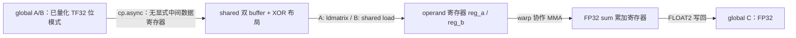

# 32. RTX 4090 D Tensor Core 优化：从作者原版到 BK32、BN64

这篇教程把两轮已经完成的实验连成一条学习路线：先尝试扩大 K 分块、减少每个 CTA 的同步次数；发现资源占用变大后，再缩小 N 分块，重新平衡每个 CTA 的工作量与驻留能力。

**实测结论有尺寸条件：BN64 在 2048 方阵上达到 57.998 TFLOPS，相对同批作者基线的逐轮配对提升中位数为 19.56%，相对 TF32 cuBLAS 为 11.57%；4096 没有继续快于作者基线。** 这里使用显式量化的 TF32 输入、FP32 累加和输出，不能表述为严格 FP32 超过 cuBLAS。BK32/BN64 两轮只优化了 TF32 路线，没有把同样改动移植并测量到 FP16，更没有 BF16 新成绩。

本页是实验完成后的教学整理，不是新增一批测量。[第 30 章](30-TensorCore-K分块实验与资源代价.md)和[第 31 章](31-TensorCore-BN64优化与尺寸效应.md)保留各自的完整报告；已有源码、CSV、SASS、NCU 文件及哈希清单保持原样。

原理前置：[微教材第 9 章](微教材/09-TensorCore从SIMT到矩阵指令.md)解释数值类型、warp 级 MMA、WMMA/PTX/SASS 与同步。
本章负责代码和实测的串联；[基础复习](22-CUDA与SGEMM基础复习.md)、[面试 QA](21-SGEMM模拟面试QA.md)提供自检，
[脚本入口表](../../scripts/README.md#tensor-core四组独立实验)区分原版、grid、BK32 和 BN64 四个子工程。

## 32.1 先分清作者代码、移植与优化

原作者为 QiLHong / vitamin-cuda。参考提交为 `520f97093a2abc239977be83d244b327d0e2e2ef`，上游路径为 `kernels/sgemm/sgemm_tf32.cu`，原函数名为 `sgemm_tf32_swizzle_bcf_dbf_kernel`。[原许可证](../../experiments/tensorcore/vendor/LICENSE)继续保留。

| 角色 | 本地实现 | 本轮如何使用 |
|---|---|---|
| 作者 device 基线 | [vendor/vitamin_tf32.cuh](../../experiments/tensorcore/vendor/vitamin_tf32.cuh) | 经过独立原生入口调用，保留算法作对照；不是 PyTorch 墙钟计时 |
| BK32 实验 | [tf32_ktile.cuh](../../experiments/tensorcore-ktile/tf32_ktile.cuh) | 保留 128×128 输出 tile，将 K 分块扩为 32，另设动态 BK16 控制版本 |
| BN64 实验 | [tf32_bn64.cuh](../../experiments/tensorcore-bn64/tf32_bn64.cuh) | 保留 BK32，将输出 tile 改为 128×64，调整 B 搬运和 fragment |
| 公平测试入口 | [BN64 benchmark.cu](../../experiments/tensorcore-bn64/benchmark.cu) | 同一个进程、同一输入重测原版、BK32、BN64 与 TF32 cuBLAS |

两个候选是基于作者思路编写的派生版本，不是“直接运行作者未修改源码”的成绩。具体改动可查看 [BK32 device.diff](../../experiments/tensorcore-ktile/device.diff) 和 [BN64 device.diff](../../experiments/tensorcore-bn64/device.diff)；来源和哈希分别记录在对应目录的 `provenance.json`。

实验报告中的 Git 起点 `b718c7b` 是当时的状态。后来发布的提交为 BK32 `3dc95f3`、BN64 `989105e`，位于 `results/rtx4090d-k30-stage2-20261021`。旧报告中“本轮未自动提交”描述的是实验结束时的状态，不表示后续没有发布。第 30 章末尾的 BN64 计划也属于当时的下一步，第 31 章已完成该实验。

## 32.2 三个分块参数分别控制什么

我们计算行主序矩阵 `A[M,K] × B[K,N] = C[M,N]`。`BM × BN` 是一个 CTA 负责的输出矩形，`BK` 是一次 shared tile 沿 K 推进的长度。CTA 在这里就是一个 CUDA thread block。

```text
某个 CTA：C[by*BM : (by+1)*BM, bx*BN : (bx+1)*BN]
每次取：  A[同一批 BM 行, 当前 BK 列]
          B[当前 BK 行, 同一批 BN 列]
沿 K 累加所有 tile 后，才写回这块 C。
```

`bx/by` 是经过 grid swizzle 后的逻辑 tile 坐标，不要直接用 `blockIdx.x/y` 替代。grid swizzle 改变 CTA 对应的矩阵位置；shared swizzle 改变 tile 内数据的存放地址，二者作用不同。

| 项目 | 作者原版 | BN128/BK32 | BN64/BK32 |
|---|---:|---:|---:|
| BM / BN / BK | 128 / 128 / 16 | 128 / 128 / 32 | 128 / 64 / 32 |
| CTA 线程数 / warp 数 | 256 / 8 | 256 / 8 | 256 / 8 |
| 一个 warp 的输出 | 64×32 | 64×32 | 64×16 |
| 每线程 FP32 累加值个数 | 64 | 64 | 32 |
| 用户 shared / CTA | 32 KiB | 64 KiB | 48 KiB |
| 实际 registers / thread | 127 | 170 | 102 |
| 实测资源条件下的理论 CTA / SM | 2 | 1 | 2 |

最后三行必须一起看。累加器只是寄存器的一部分；地址、A/B operand 和编译器临时值也占寄存器。三个版本均未观察到 spill，但“没有 spill”不等于资源开销没有代价。

双缓冲的用户 shared 字节数为 `2 × (BM×BK + BK×BN) × 4`。原版到 BK32，输出形状没变，A/B 全矩阵的理论请求总量也没变；只是把更多 K 工作装进一次迭代，同时使 shared 翻倍。

## 32.3 顺着 BN64 代码推导一个线程

建议在 `tf32_bn64.cuh` 中依次找 `warp_id_m`、`sum`、`copy_tile`、`M16N8K8`、`Write back C`。

八个 warp 排成 2 行、4 列。对 `tid=0..255`：

```text
warp = tid / 32                 lane = tid % 32
warp_m = warp / 4               warp_n = warp % 4
mi = 0..3                      ni = 0..1
r = 0..3                       // 一个 m16n8 输出 fragment 中本 lane 的四个值

row = by*128 + warp_m*64 + mi*16 + lane/4 + (r/2)*8
col = bx*64  + warp_n*16 + ni*8  + (lane%4)*2 + r%2
```

这里整数除法向下取整。一次 `m16n8k8` 是整个 warp 协作完成的 16×8×8 乘加，不是每个线程独立计算一个 16×8 矩阵。一个 warp 的 32 个 lane 各持有 4 个结果，合起来是 128 个输出；四个 `mi`、两个 `ni` 将其铺成 64×16。

warp 0、`mi=ni=0` 时的 CTA 内坐标为：

| lane | `r=0,1,2,3` 对应的四个输出 |
|---:|---|
| 0 | (0,0)、(0,1)、(8,0)、(8,1) |
| 1 | (0,2)、(0,3)、(8,2)、(8,3) |
| 2 | (0,4)、(0,5)、(8,4)、(8,5) |
| 31 | (7,6)、(7,7)、(15,6)、(15,7) |

每线程有 `4×2×4=32` 个输出，整个 CTA 是 `256×32=8192=128×64`。数量相等只是必要条件；[CPU 枚举脚本](../../scripts/analyze_tensor_bn64_mapping.py)还逐坐标检查了覆盖、重复和越界。原版的 `ni=0..3`，warp 的列跨度为 32；因此改 BN 时不能只改 launch grid 而保留旧写回公式。

## 32.4 搬运归属与输出归属是两张表

`copy_tile(slot, kk)` 中，一个 BK32 tile 分成两个宽 16 的 K slab。对 `slab=0,1`、包内元素 `e=0..3`，搬运的逻辑坐标为：

```text
A 行：by*128 + tid/4，或再加 64
A 列：kk + slab*16 + (tid%4)*4 + e
B 行：kk + slab*16 + tid/16
B 列：bx*64 + (tid%16)*4 + e
```

每线程每 slab 搬两包 A、一包 B，每包 16 字节；两个 slab 共六次 `cp.async`。线程搬来的值会由其他线程或 warp 消费，因此不能把“我加载的 A/B”理解为“只给我的输出使用”。

shared 逻辑布局为：

```text
As[buffer=2][slab=2][row=128][col=16]  -> 32768 bytes
Bs[buffer=2][slab=2][row=16 ][col=64]  -> 16384 bytes
A shared_col = col XOR (((row >> 1) & 3) << 2)
B shared_col = col XOR ((row & 7) << 3)
```

生产者按 XOR 后的地址写入，消费者用相同规则寻找数据，逻辑矩阵的值没有改变。用两个 16 宽 slab，而不是直接把 A 的行宽改成 32，是为了保留原有行跨度与 swizzle 结构。A/B 的两组 buffer 物理上分别连续存放；把“slot 0”画成一块 24 KiB，只是逻辑示意。

计算阶段，A 通过 `ldmatrix.x4.b16` 装入 operand 寄存器，B 通过 shared load 装入寄存器，然后送入 `mma.sync...f32.tf32.tf32.f32`。这里的 `.b16` 是加载指令的组织方式，不能据此说 A 被改成了 FP16 运算；实际 operand 精度应看 MMA 类型及输入转换。



地址计算仍需要寄存器。当前实现直接写回 C，没有另加精度转换或 epilogue kernel。

## 32.5 双缓冲究竟保护了什么

按逻辑 K tile 观察，执行顺序是：

| 时段 | shared slot 0 | shared slot 1 | 同步责任 |
|---|---|---|---|
| 序言 | 复制 tile 0 | 空闲 | commit → wait → CTA barrier 后才能消费 |
| 第一次循环 | 读取并计算 tile 0 | 异步复制 tile 1 | wait 等新数据；barrier 协调全 CTA |
| 第二次循环 | 覆盖为 tile 2 | 读取并计算 tile 1 | 旧 slot 必须读完，才允许复用 |
| 尾部 | 消费最后一个已加载 tile，具体 slot 由奇偶决定 | 同左 | 不再发起超出 K 的预取 |

`cp.async.wait_group 0` 等本线程已提交的异步拷贝完成；`__syncthreads()` 让全 CTA 在生产、消费和复用 slot 的边界上会合。双 buffer 使当前读取与下一 tile 写入使用不同地址，但不自动保证所有生产者和消费者到达同一阶段。

BK16 到 BK32，每个 CTA 的 barrier 执行次数从 `K/16` 变为 `K/32`。BN128 到 BN64，CTA 数量又翻倍，所以 BN64 相对原版的**整个 GEMM 的 CTA barrier 调用总数没有减少**。barrier 调用数、barrier stall 指标和耗时不是同一个量。

最终 SASS 也不能省略：BN64 的 K 主循环中有 6 条 `LDGSTS`、32 条 `HMMA`，最后一次 copy 与完成等待 `DEPBAR.LE` 之间有 27 条 `HMMA`；等待后仍有 5 条。见[真实主循环片段](../../results/windows/20261021-tensorcore-bn64/evidence02/bn64-main-loop.sass.txt)。这支持“机器码中存在搬运与计算交错”，但不能证明访存延迟已完全隐藏。`LDGDEPBAR` 是提交相关指令，不应与完成等待混淆。

## 32.6 怎样读性能表才不会比较错

共同条件：Windows 原生 RTX 4090 D、114 SM、驱动 610.60、CUDA 12.4.131、MSVC 19.37、Release / sm_89；`C=AB`、seed=20261020、同一份显式 TF32 输入。cuBLAS 使用 `CUBLAS_COMPUTE_32F_FAST_TF32`，PEDANTIC FP32 仅作数值参考。

每批每个尺寸七轮；每轮每实现预热十次，记录三十次单调用 CUDA event。每次调用前同 stream 恢复 C0，恢复在 event 外。恢复会影响缓存，且转换时间不在主表内，所以这是既定输入的 kernel 计时，不是端到端应用加速。

下面四列**全部来自 BN64 实验同一批 `run01`**，不拼接不同实验日期或旧 `alpha=0.5,beta=3` 成绩，单位 TFLOPS：

| N | 作者 BK16 | BN128/BK32 | BN64/BK32 | TF32 cuBLAS |
|---:|---:|---:|---:|---:|
| 1024 | 31.379 | 31.964 | 32.665 | 35.601 |
| 2048 | 48.479 | 46.163 | 57.919 | 51.771 |
| 4096 | 71.573 | 66.941 | 71.275 | 69.136 |

随后独立 `confirm01` 比较作者原版、BN64 与 cuBLAS。下列百分比按轮配对计算，括号是胜出轮数：

| N | BN64 TFLOPS | 相对作者原版 | 相对 TF32 cuBLAS |
|---:|---:|---:|---:|
| 1024 | 32.599 | +4.11%（7/7） | −8.45%（0/7） |
| 2048 | 57.998 | +19.56%（7/7） | +11.57%（7/7） |
| 4096 | 71.156 | −0.43%（2/7） | +2.79%（7/7） |

复算定义见 [summarize_tensor_bn64.py](../../scripts/summarize_tensor_bn64.py)：

```text
t_round = mean(该轮 30 个 event 毫秒数)
t_report = median(七个 t_round)
TFLOPS = 2*N^3 / (t_report * 10^9)
gain_round = (t_reference_round / t_candidate_round - 1) * 100%
gain_report = median(七个 gain_round)
```

“两个中位数相除”通常不等于“七个比值的中位数”。2048 相对原版的七轮范围为 +19.32%..+19.88%；4096 只有两轮快于原版，不支持继续提速的结论。所有慢 event 均保留，主表没有使用最好的一轮。初测和确认共 4410 个正式 event；NCU 插桩时间单独归档，不混入这些统计。

原始入口：[初测统计](../../results/windows/20261021-tensorcore-bn64/analysis01/summary.csv)、[确认统计](../../results/windows/20261021-tensorcore-bn64/confirm-analysis02/summary.csv)、[逐轮配对](../../results/windows/20261021-tensorcore-bn64/confirm-analysis02/paired-rounds.csv)。本机未锁频，两批遥测覆盖 43..53°C、SM 2520..2715 MHz；这是同日固定输入实验，不是跨设备或任意形状保证。

## 32.7 为什么 2048 和 4096 不同

**已验证：BK32 的资源目标没有平衡好。** 用户 shared 从 32 KiB 到 64 KiB、寄存器从 127 到 170，理论 CTA/SM 从 2 到 1。2048/4096 的 eligible warp 和 Tensor 活跃指标下降，与计时回退方向一致。即使只限制寄存器，两个 64 KiB 的 CTA 也放不进本次 100 KiB/SM 的 shared 配置。

**已验证：BN64 恢复了两个 CTA 的驻留能力，同时改变了任务数量和访存量。** 用户 shared 为 48 KiB；含 NCU 报告的 driver 开销，每 CTA 为 50176 字节，两个共 100352 字节，小于本次配置的 102400 字节。2048 的 CTA 从 256 增到 512，4096 从 1024 增到 2048；每个 CTA 负责的输出减半。

NCU 补采区分了两种 Tensor 指标的分母。主采样与补采各自对每种配置采集一次 launch，不是重复统计：

| N / 实现 | SM 活跃周期 / 经过周期 | Tensor active | Tensor elapsed |
|---|---:|---:|---:|
| 2048 原版 | 75.17% | 44.25% | 33.26% |
| 2048 BN64 | 89.49% | 44.49% | 39.82% |
| 4096 原版 | 99.37% | 45.88% | 45.59% |
| 4096 BN64 | 99.47% | 45.85% | 45.61% |

原始指标摘录见 [elapsed-selected.csv](../../results/windows/20261021-tensorcore-bn64/evidence02/elapsed-selected.csv)；访存、shared 和资源数据见 [ncu-selected.csv](../../results/windows/20261021-tensorcore-bn64/evidence02/ncu-selected.csv)。

`active` 只以活跃周期为分母，`elapsed` 包含整个经过时间。2048 的 active 接近，但有任务的 SM 时间比例更高，因此 elapsed 明显提高；“更多、较小的 CTA 改善任务分配及尾部空闲”是有计数器支持的解释。4096 原版已经在约 99% 的经过周期内活跃，这个方向的空间更小。没有逐 SM 调度轨迹，不能把全部收益精确归因于尾波。

**已验证的代价：A 请求增加。** 沿 N 把一个输出 tile 拆成两个，各自都需要同一块 A。忽略 C：

```text
全 GEMM 的逻辑 A 请求量 = (N/BN) * M*K * 4 bytes
全 GEMM 的逻辑 B 请求量 = (M/BM) * K*N * 4 bytes
BN128 -> BN64：A 变为 2 倍，B 不变；两者合计为原来的 1.5 倍。
```

2048 的 NCU DRAM 读取约 33.74→33.56 MB，4096 则为 364.27→493.35 MB。L2 请求增加不一定都到 DRAM；但在更大的矩阵上，额外请求的实际代价更明显。4096 L2 命中率虽从 94.72% 到 95.65%，总请求更多，DRAM 读取仍增加约 35.4%。不要单看命中率判断是否优化成功。

上述指标支持“任务分配收益与额外访存代价相互制约”的解释。BN64 同时改变 CTA 大小、fragment、资源和复用，不能包装成只改变 occupancy 的因果实验。

## 32.8 正确性通过到哪一层

本轮 156 次相对作者原版的全量逐位比较均为零差异；GPU 参考检查覆盖全量输出。小矩形 128×1024、K=32/64/96 的 CPU double 检查全量，1024/2048/4096 方阵只抽固定 256 个位置。全部 864 行参考检查没有 NaN/Inf。

但相对原始 FP32 输入的最大绝对误差分别为 0.344390869、0.503967285、0.747344971，**绝对误差≤0.01 和原 SIMT allclose 都失败**。相对量化输入的原 TF32 allclose 通过，也不能消除输入量化误差。对已量化输入的 PEDANTIC FP32 参考，2048/4096 的全量检查中，绝对 0.01 和 SIMT allclose 仍有失败；4096 的量化输入 CPU double 抽样也有十点超过绝对 0.01。

沿用 harness 的判定方向为 `abs(got-ref) <= atol + rtol*abs(got)`：SIMT 的两个参数为 0.001，TF32 为 0.1，分别报告，不相互替代。完整最大相对误差及失败计数见[误差汇总](../../results/windows/20261021-tensorcore-bn64/confirm-analysis02/errors.csv)。Sanitizer 本轮未运行，仍为未验证。

## 32.9 按目的选择复跑命令

下面使用本机已验证的 PowerShell 7、Python 和工具链路径，不安装软件。`Build-*` 在子进程初始化已有 MSVC/CUDA，默认 Release / sm_89；原生 benchmark 不需要 PyTorch。共同主机入口只接受 M=128..4096 且为 128 的整数倍、N=1024..4096 且为 1024 的整数倍、K=32..4096 且为 32 的整数倍。核内没有尾块保护，不能绕过检查。

先在普通 PowerShell 设置路径。每次都使用新目录，显式传输出路径，避免向冻结归档追加文件：

```powershell
Set-Location 'D:\CUDA-Lab\cuda-learning\SGEMM_CUDA'
$ps7 = 'C:\Users\Administrator\.cache\codex-runtimes\codex-primary-runtime\dependencies\native\powershell\pwsh.exe'
$py = 'D:\Anaconda\Anaconda\python.exe'
$stamp = Get-Date -Format 'yyyyMMdd-HHmmss'
$out = "results\windows\tensorcore-learning-$stamp"
```

只学习映射、复算已发布成绩时，不需要启动 GPU。`--verify` 检查生成文本一致性，会规范读取时的换行，不等同于归档的逐字节 SHA256 校验：

```powershell
& $py scripts\prepare_tensor_bn64.py --verify
if ($LASTEXITCODE) { throw 'source derivation differs' }
& $py scripts\analyze_tensor_bn64_mapping.py --output "$out\mapping"
if ($LASTEXITCODE) { throw 'mapping failed' }
& $py scripts\summarize_tensor_bn64.py `
    --run results\windows\20261021-tensorcore-bn64\confirm01 `
    --output "$out\saved-confirm-analysis"
if ($LASTEXITCODE) { throw 'saved event analysis failed' }
```

需要重新测量时，BN64 target 已包含原版、父 BK32 和 cuBLAS，无需再从根目录构建所有历史 target：

```powershell
$build = "build-windows-tensor-bn64-$stamp"
& $ps7 -NoProfile -File scripts\windows\Build-TensorBN64.ps1 `
    -BuildDir $build -EvidenceDir "$out\build" -Python $py
if ($LASTEXITCODE) { throw 'build failed' }
& $ps7 -NoProfile -File scripts\windows\Run-TensorBN64.ps1 `
    -BuildDir $build -OutputDir "$out\run" -Selection all -Rounds 7 -Warmup 10 -Repeats 30
if ($LASTEXITCODE) { throw 'run failed; keep raw evidence' }
& $ps7 -NoProfile -File scripts\windows\Run-TensorBN64.ps1 `
    -BuildDir $build -OutputDir "$out\confirm" -Selection confirm -Rounds 7 -Warmup 10 -Repeats 30
if ($LASTEXITCODE) { throw 'confirmation failed' }
& $py scripts\summarize_tensor_bn64.py --run "$out\run" --output "$out\analysis"
if ($LASTEXITCODE) { throw 'analysis failed' }
& $py scripts\summarize_tensor_bn64.py --run "$out\confirm" --output "$out\confirm-analysis"
if ($LASTEXITCODE) { throw 'confirmation analysis failed' }
```

`all` 让父 BK32 与 BN64 相邻并交换先后；`confirm` 让作者原版与 BN64 相邻并交换先后，cuBLAS 轮换位置。运行脚本会先检查小矩形和非法形状，再做正式尺寸。新构建目录保留本次旧二进制；新输出目录保留所有慢样本。

只有需要 profiler 证据时再执行以下可选块；失败保留输出，不把 profiler 故障解释为 benchmark 数值失败：

```powershell
& $ps7 -NoProfile -File scripts\windows\Profile-TensorBN64.ps1 `
    -BuildDir $build -OutputDir "$out\profile"
if ($LASTEXITCODE) { throw 'profile failed; benchmark results remain separate' }
& $ps7 -NoProfile -File scripts\windows\Profile-TensorBN64Elapsed.ps1 `
    -BuildDir $build -OutputDir "$out\profile-elapsed"
if ($LASTEXITCODE) { throw 'elapsed profile failed' }
& $py scripts\summarize_tensor_bn64.py --run "$out\confirm" `
    --profile "$out\profile-elapsed" --output "$out\elapsed-analysis"
if ($LASTEXITCODE) { throw 'elapsed analysis failed' }
```

需要单独重做 BK16 动态 shared 控制实验时，使用[第 30 章的完整命令](30-TensorCore-K分块实验与资源代价.md#308-下一次怎样复跑)。旧 `audit_tensor_*` 还核验实验前源码快照；后续文档或源码有合法变化时可能失败，它不是任意新工作区的通用检查。不要修改旧清单来让它通过，也不要对旧结果重新运行 `finalize_*`。

本次文档整理实际执行了 CPU 映射、生成文本校验和旧 event 复算；五份重算 CSV 与冻结结果逐字节一致。上面的 GPU 构建、计时与 profiler 命令按现有脚本核对并通过 PowerShell 语法检查，本次没有为写文档重新运行 GPU 实验。

## 32.10 五个练习与答案

1. BN64 中，warp 1、lane 31、`mi=3, ni=1` 的四个输出坐标是什么？
2. `tid=31, slab=1, kk=0` 搬运哪些 A/B？它们写入哪个 shared 列范围？忽略 CTA 全局基址。
3. 为什么 BK32 的 barrier 每 CTA 减半，而 BN64 相对原版整个 GEMM 的 barrier 总数没减半？
4. 为什么 2048 的 Tensor active 只变化很小，整体却快约 19.6%？可以据此证明全部收益来自尾波吗？
5. “与原版逐位一致，且超过 cuBLAS”为什么仍不能写成“严格 FP32 SGEMM 优化成功”？

<details>
<summary>完成手算后查看参考答案</summary>

1. CTA 内坐标为 (55,30)、(55,31)、(63,30)、(63,31)。再加 `(by*128,bx*64)` 得到全局坐标。
2. A 行 7 和 71、K 列 28..31；写入各自 `As[slot][1][row][0..3]`，因为列 12..15 与 12 做 XOR。B 的 K 行 17、列 60..63；写入 `Bs[slot][1][1][52..55]`，因为列 60..63 与 8 做 XOR。shared 的 slab 内行列不要与全局 K 坐标混用。
3. BK 翻倍使每 CTA 的次数减半；BN 减半又使 CTA 数量翻倍。总调用数相乘后保持不变，实际等待时间仍可能变化。
4. active 的分母排除了非活跃周期。SM 活跃时间比例从 75.17% 到 89.49%，Tensor elapsed 从 33.26% 到 39.82%。这支持任务分布改善的解释，但缺少逐 SM 调度轨迹，且其他因素也变化，不能分解全部因果贡献。
5. 基线和候选共享同一 TF32 量化输入，逐位一致只说明这些实现间输出一致。原始 FP32 的误差标准仍失败，性能对照也是 TF32 cuBLAS；还必须说明尺寸、计时范围和复测条件。

</details>

下一项待验证的假设：固定 BN64/BK32、精度、线程映射与同步，只改变 grid 分组宽度 W=1/2/4/8，观察 4096 的额外 A 请求能否更好利用 L2，同时检查 B 复用是否受损。这是后续实验建议，本页没有执行它，也没有预告提速。

后续已完成的公开库对照见[第 34 章](34-CUTLASS与BN64的4090D公平对照.md)：CUTLASS 在同输入 TF32 下的一个固定配置快于 BN64，但 occupancy 更低、bank conflict 更多。新数据支持继续检查 shared operand 读取工作量；本页的旧成绩与未执行假设保持原意，不与新批次混算。
