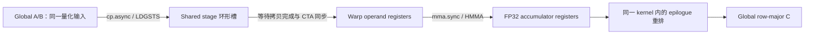

# 34：CUTLASS 与 BN64 的 RTX 4090 D 公平对照

本轮在 Windows 原生环境实际编译、运行了 NVIDIA CUTLASS 3.5.1，并与作者 TF32、BN64、K10、K30 V2 和 cuBLAS 重新比较。**预先选定的 CUTLASS 128×64×16 TF32 配置在四个尺寸都快于 BN64；公开 SIMT 配置没有超过 K30 或严格 FP32 cuBLAS。** 这是有限配置、固定输入分布和本机测量协议下的结果，不代表 CUTLASS 全库最优。

完整证据入口：[独立归档](../../results/windows/20261022-cutlass-rtx4090d/README.md)、[全部统计与误差表](../../results/windows/20261022-cutlass-rtx4090d/analysis01/README.md)。本章没有复用 RTX 3080 或前一批 BN64 的吞吐填表，也没有修改原有 device kernel。

## 34.1 来源、环境与真正调用的代码

- SGEMM 起点：`a2b23dabadc79440bf9cbf63f0b566f7eec429ba`；分支 `results/rtx4090d-k30-stage2-20261021`。本轮新增内容尚未提交或推送。
- vitamin-cuda 参考提交仍为 `520f97093a2abc239977be83d244b327d0e2e2ef`，没有更新其工作区。
- CUTLASS：官方 v3.5.1，`f7b19de32c5d1f3cedfc735c2849f12b537522ee`，独立检出到 `D:\CUDA-Lab\cuda-learning\deps\cutlass-v3.5.1`。未修改上游头文件；保留 NVIDIA 版权和 BSD-3-Clause 许可证。
- GPU：RTX 4090 D，24564 MiB，114 SM；驱动 610.60，WDDM。
- 实际编译器：Windows CUDA **12.4.131**，MSVC **19.37.32826.1**（工具集目录 14.37.32822），Windows SDK 10.0.26100.0，CMake 3.31.6-msvc6，Ninja 1.12.1。
- Release、`-O3`、`arch=compute_89,code=[compute_89,sm_89]`；没有 `--use_fast_math` 或忽略编译器版本检查。保留正常 FP32 FMA。`nvidia-smi` 显示的 UMD CUDA 13.3 不是本轮 nvcc 版本。

先读 [cutlass_adapter.cuh](../../experiments/cutlass-rtx4090d/cutlass_adapter.cuh)，再看 [benchmark.cu](../../experiments/cutlass-rtx4090d/benchmark.cu)。wrapper 只实例化并调用官方 `cutlass::gemm::device::Gemm`，没有自行重写 CUTLASS 主循环。配置对应的官方文件、固定提交链接和适配边界在 [CUTLASS-PROVENANCE.md](../../experiments/cutlass-rtx4090d/CUTLASS-PROVENANCE.md)。

| 运行名 | CTA M×N×K | warp M×N×K | 指令 M×N×K | stage | 线程 | 乘法 |
|---|---|---|---|---:|---:|---|
| `cutlass_tf32_128x128` | 128×128×32 | 64×64×32 | 16×8×8 | 3 | 128 | TF32×1 |
| `cutlass_tf32_128x64_bk16` | 128×64×16 | 64×32×16 | 16×8×8 | 4 | 128 | TF32×1 |
| `cutlass_simt_256x128` | 256×128×8 | 64×64×8 | 1×1×1 | 4 | 256 | FP32 FFMA |

两个 TF32 配置来自官方 row-major 单元测试，在第一次性能测量前选定；它们覆盖 96 KiB 和 48 KiB 的 shared 需求。SIMT 配置沿用[第 16 章](16-公开CUTLASS对照与主循环成本审计.md)的公开模板。本轮没有搜索全部 tile 或自动调优。所有配置均为 row-major A/B/C、FP32 累加和输出、identity swizzle 1、split-K=1。`Sm80` 是模板所用特性集，实际二进制为 **sm_89**。

## 34.2 怎样保证比较的是同一道题

两组都计算 **C=AB，alpha=1、beta=0**，但输入精度分开：

| 组 | 实现 | 实际输入与 cuBLAS 配置 |
|---|---|---|
| TF32 | 作者版、BN64、两个 CUTLASS、cuBLAS | 同一份由 GPU `__float_to_tf32` 量化的 A/B；`CUBLAS_COMPUTE_32F_FAST_TF32`，禁止 reduced-precision reduction |
| Strict FP32 | K10 PAD4、K30 V2、CUTLASS SIMT、cuBLAS | 同一份原始 FP32 A/B；`CUBLAS_COMPUTE_32F_PEDANTIC`、`CUBLAS_PEDANTIC_MATH` |

全部 TF32 实现共用同一对设备指针，全部 FP32 实现也共用一对设备指针。seed 为 20261020、42、12345；记录 GPU 回读数据的 FNV1a64，验证跨批次、跨组对应表示及运行前后字节一致。新 harness 只生成 TF32 表示，没有前一实验的 FP16 附带输出；转换不在 GEMM event 内。

每组 3 个独立进程批次，每批 3 seed × 4 尺寸（1024、2048、3072、4096）；每例 **7 轮，每实现每轮预热 10 次、计时 30 次**。实现顺序轮换并反向，尺寸和 seed 顺序随批次轮换。总计 **68040 个原始 event、2268 个轮组、72 个案例、324 个实现汇总**，没有删除慢样本。

每次预热及测量前，在同一 default stream 上 D2D 恢复零 C0，恢复位于开始 event 之前；所有实现同一策略。这样可重现，但输出大小的写入可能影响 L2，不能称为冷缓存实验。`initialize()`、`can_implement()`、workspace 分配、输入转换及正确性检查都在计时外。CUTLASS 公开 `run()` 对至少 48 KiB shared 的实例每次保留 `cudaFuncSetAttribute`；单次 event 包围公开发射 API，可能包含设备可见的主机提交空隙，尤其影响小矩阵。这不是 CUDA Graph 测量。

主机入口明确限制 M 为 128 的倍数且在 [128,4096]，N 为 1024 的倍数且在 [1024,4096]，K 为 32 的倍数且在 [32,4096]。这些是整个比较入口的共同限制，保护没有尾块检查的作者实现；不是声称 CUTLASS 本身只能处理这些形状。

统计先计算一轮 30 个 event 的均值，再取 7 个轮均值的中位数；吞吐为 `2*N^3/(median_ms*1e9)`。下表是 9 个 batch/seed 组合吞吐的中位数。每轮配对收益单独计算 `reference_ms/candidate_ms-1`，不拿两组最大值相除。全部范围、CV、逐轮配对和误差见 CSV；没有将 event 当作独立同分布样本来宣称统计显著性。

## 34.3 实测：TF32 与严格 FP32 分表

TF32，单位 TFLOPS。CUT 小配置指 128×64×16、4-stage；大配置指 128×128×32、3-stage。

| N | 作者 TF32 | BN64 BK32 | CUT 大配置 | CUT 小配置 | 同输入 TF32 cuBLAS |
|---:|---:|---:|---:|---:|---:|
| 1024 | 31.408 | 32.647 | 35.525 | **35.851** | 35.487 |
| 2048 | 48.480 | 57.939 | 51.932 | **62.946** | 51.776 |
| 3072 | 54.823 | 59.447 | 58.000 | **64.203** | 58.799 |
| 4096 | 69.723 | 69.300 | 73.978 | **74.780** | 67.287 |

| N | CUT 小配置九组合吞吐范围 | 相对 BN64 的九组合配对中位数范围 | 相对 cuBLAS 的范围 | 对 cuBLAS 正收益轮 |
|---:|---:|---:|---:|---:|
| 1024 | 35.644～38.388 | +9.142%～+10.534% | +0.120%～+2.508% | 58/63 |
| 2048 | 62.710～63.075 | +8.095%～+8.803% | +21.307%～+21.762% | 63/63 |
| 3072 | 63.080～64.281 | +7.327%～+9.157% | +7.963%～+9.413% | 63/63 |
| 4096 | 74.257～75.073 | +6.810%～+8.725% | +10.274%～+11.714% | 63/63 |

CUT 小配置相对 BN64 的正收益轮分别为 63/63、63/63、62/63、63/63；四个尺寸均 9/9 组合配对中位数为正。1024 相对 cuBLAS 的收益较小，不能据此保证其他运行环境同样领先。其各尺寸最大轮均值 CV 分别约 3.74%、1.47%、4.00%、3.43%。

大配置提供了反例：2048 相对 BN64 **慢 10.22%～10.57%**，3072 的九组合中只有 1 个正收益，4096 才稳定领先。不能只凭“用了 CUTLASS”预测快慢。

Strict FP32，单位 TFLOPS；没有启用 Tensor Core TF32。

| N | K10 PAD4 | K30 V2 | CUTLASS SIMT | Strict FP32 cuBLAS |
|---:|---:|---:|---:|---:|
| 1024 | 21.428 | 23.189 | 14.093 | **30.675** |
| 2048 | 28.725 | 30.801 | 27.350 | **44.506** |
| 3072 | 41.454 | 41.687 | 37.241 | **45.730** |
| 4096 | 44.277 | 45.446 | 43.897 | **48.128** |

这一个 CUTLASS SIMT 配置没有任何尺寸的组合配对中位数超过 K30 或 cuBLAS。4096 相对 K30 慢 2.73%～4.81%，相对 cuBLAS 慢 7.91%～9.73%；不能把上面的 TF32 领先写成严格 FP32 领先。

## 34.4 正确性：通过哪些标准，失败哪些标准

小尺寸为 M=128、N=1024、K=32/64/96，两组共 6 例，对每例 **全部 131072 个输出**做 CPU double 检查。累计覆盖 786432 个输出坐标；正式大矩阵对 GPU 参考检查全量输出，对 CPU double **只抽样 256 点**，位置保存在 `.cpu-indices.csv`，不宣称大矩阵 CPU 全量验证。另执行了 6 个非法形状拒绝测试。

沿用绝对误差 `<=0.01`，SIMT allclose `abs(got-ref)<=0.001+0.001*abs(got)`，TF32 native allclose 的 eps 为 0.1。两种 allclose 使用 `got` 一侧作相对项，不能误写成 NumPy 默认公式。最大相对误差以 `max(abs(ref),1e-12)` 为分母；全部 max_abs、max_rel、relative_l2、失败数和 NaN/Inf 保存在 `analysis01/errors.csv` 和 `correctness-by-reference.csv`。

以下取所有实现、batch、seed 和适用参考的最坏值：

| N | TF32 对同一量化输入参考 max_abs | TF32 abs≤0.01 | TF32 native eps=0.1 | Strict FP32 max_abs | FP32 abs≤0.01 | FP32 SIMT allclose |
|---:|---:|---|---|---:|---|---|
| 1024 | 0.003845215 | PASS | PASS | 0.001312256 | PASS | PASS |
| 2048 | 0.01293945 | **FAIL** | PASS | 0.003417969 | PASS | PASS |
| 3072 | 0.02136230 | **FAIL** | PASS | 0.005615234 | PASS | **FAIL** |
| 4096 | 0.03076172 | **FAIL** | PASS | 0.002008449 | PASS | PASS |

所有正式记录无 NaN/Inf。TF32 五个实现对作者版的 1440 条全量位比较记录均为零 mismatch，但相同输出并不意味着满足所有精度标准：TF32 的 SIMT eps=0.001 在四尺寸均有失败；对**原始 FP32**参考的 max_abs 分别为 0.3443909、0.5679932、0.6939697、0.7731018，绝对门限全部失败。

FP32 的 3072 有 **720 条检查记录**不满足 SIMT allclose（这是检查记录数，不是不同错误元素数）。K10/K30/CUTLASS 与 strict cuBLAS 的交叉参考存在差异，各实现合并参考后都标为 FAIL；不能单凭此判定 CUTLASS 算法出错，也不能用 abs 门限通过替换 allclose 失败。尚未对每个失败位置做 CPU double 定点归因，累加顺序差异是待核实解释。

`DATA_AUDIT_PASS` 仅表示记录、计划、输入、恢复链和统计完整性通过，**不表示所有数值阈值通过**。本轮没有成功完成 Compute Sanitizer，内存/竞争 sanitizer 状态为未验证。

## 34.5 沿着代码理解 CUTLASS 的数据流

入口调用链为 `benchmark.cu` 的 `Data::launch` → adapter `Instance::run` → 官方 `device::Gemm::run` → `kernel::Gemm` → `threadblock::MmaMultistage`。初始化时 stride 是 A 的 K、B/C 的 N；`alpha=1,beta=0`，C 与 D 指向同一输出缓冲区。CUTLASS 自带 epilogue 在同一个 GEMM kernel 内完成写回，没有额外 epilogue kernel。

以小 TF32 配置为例，一个 CTA 负责 128×64 个输出；4 个 warp 各负责 64×32。官方 `mma_multistage.h` 的计算为 `warp_m=warp_id%WarpCountM`、`warp_n=warp_id/WarpCountM`，本例 `WarpCountM=2`，所以 warp 0/1/2/3 的 tile 起点依次是 (0,0)、(64,0)、(0,32)、(64,32)。每个 warp 在 K 方向累加同一输出区域，不是 32 条线程各调用一次独立 GEMM。每条 m16n8k8 MMA 的输出 fragment 分布在 32 个 lane 的寄存器中，再由 CUTLASS 的 accumulator/epilogue iterator 映射回 row-major C；不能将 fragment 数组下标直接当连续行列号。

一个 stage 的 A/B 数据为 `(128*16+16*64)*4=12288` 字节，4-stage 共 49152 字节。大配置为 `(128*32+32*128)*4*3=98304` 字节。小配置的 global iterator 使用 `PredicatedTileAccessIterator`；shared A 采用 TensorOp Crosswise 布局，B 采用 Congruous 布局，随后 warp iterator 把数据取到 MMA operand fragment。具体物理地址由这些 layout 类计算，不能把 shared 当成未经排列的 A/B 二维副本。



多阶段主循环先预装后续 tile，再将未来数据的异步拷贝分散到当前 tile 的 MMA 工作之间。源码维护 `smem_write_stage_idx_`、`smem_read_stage_idx_`，槽号到 stages 后回绕；`cp_async_wait<Stages-2>()` 限制尚未完成的拷贝组，再用 `__syncthreads()` 协调 CTA 线程。前者保证异步数据就绪，后者协调跨线程消费和 shared 槽复用，两者不能随意互相替代；收尾还会 drain 等待。搬运使用 `cp.async`，不经过普通 FP32 数据寄存器中转，但地址和 MMA operand/accumulator 仍消耗寄存器。

**这里没有 TMA。** 二进制中实际看到的是 `cp.async`/`LDGSTS`、`mma.sync`/`HMMA.1688.F32.TF32`，未看到 TMA `cp.async.bulk`、WGMMA 或 tcgen05。CUTLASS 的 `tfloat32_t + OpMultiplyAdd` 及实际 PTX 共同确认单 TF32 MMA，未用 TF32x3、FP16 或 BF16。单看 SASS 中出现 HMMA 不足以推断整个算法是不是 TF32x3。

## 34.6 NCU 与 SASS：哪些证据支持性能解释

已有 Nsight Compute 2024.1.1 成功完成 **2048/4096 × 5 实现，共 10 次**定点采集。使用 kernel replay、`--clock-control none --cache-control none`，固定 seed 20261020。stock sections 复制到 Documents 的警告后使用安装目录 fallback，未绕过权限。所有 profiler 时间与公平 benchmark 分开。

| 实现 | registers/thread | 用户 shared/CTA | threads | ptxas spill load/store |
|---|---:|---:|---:|---|
| CUT 大 TF32 | 230 | 98304 B | 128 | 0/0 |
| CUT 小 TF32 | 142 | 49152 B | 128 | 0/0 |
| BN64 | 102 | 49152 B | 256 | 0/0 |
| CUT SIMT | 254 | 49152 B | 256 | 0/0 |
| K30 V2 | 235 | 33280 B | 128 | 0/0 |

十次 NCU 的 local load/store sectors 也均为 0。NCU shared 总量比用户 shared 多 1024 B driver 开销，例如小 TF32 为 50176 B；`cuobjdump SHARED=0` 只说明静态 shared 为零，不能忽略发射时的动态分配。

下表数值为 **2048 / 4096**。occupancy、issue、Tensor/FMA 为各自 NCU 百分比指标；eligible 和 barrier stall 的原始单位为 warp，不能把 `.38` 写成 38%。Tensor 使用 elapsed 分母，FMA 使用 active 分母，两者不能相加。

| 实现 | achieved occupancy % | eligible warps | issue % | Tensor elapsed % | FMA active % | barrier stall warps |
|---|---|---|---|---|---|---|
| CUT 大 TF32 | 8.30 / 8.34 | .08 / .08 | 8.13 / 8.07 | 35.69 / 48.43 | — | .01 / 0 |
| CUT 小 TF32 | 14.87 / 16.22 | .15 / .15 | 12.20 / 12.07 | 43.39 / 48.87 | — | .05 / .03 |
| BN64 | 29.87 / 32.50 | .19 / .20 | 10.36 / 10.51 | 39.86 / 45.61 | — | .38 / .43 |
| CUT SIMT | 16.66 / 16.66 | 1.43 / 1.45 | 79.98 / 80.58 | — | 69.23 / 69.86 | .08 / .07 |
| K30 V2 | 15.38 / 16.29 | 1.31 / 1.36 | 81.33 / 78.81 | — | 74.22 / 72.88 | .06 / .06 |

| 实现 | shared-load wavefront（2048 / 4096） | load bank conflicts（2048 / 4096） | store bank conflicts（2048 / 4096） |
|---|---|---|---|
| CUT 大 TF32 | 8552448 / 67764224 | 0 / 0 | 0 / 0 |
| CUT 小 TF32 | 13011340 / 102381313 | 243879 / 979275 | 22504 / 101516 |
| BN64 | 20988231 / 167898844 | 14613 / 115759 | 0 / 0 |
| CUT SIMT | 25309184 / 201900032 | 0 / 0 | 0 / 0 |
| K30 V2 | 25169040 / 201352622 | 3216 / 25859 | 2127369 / 18062097 |

完整 shared-store wavefront、long/short scoreboard、L2/DRAM、原始单位在 [metrics.csv](../../results/windows/20261022-cutlass-rtx4090d/profile-analysis01/metrics.csv)。例如 BN64 的 short scoreboard 为 .15/.16 warp，CUT 小配置为 .01/0；K30 long scoreboard 为 .18/.22，CUT SIMT 为 0/0，但 CUT SIMT 仍慢于 K30。单个 stall 低不等于总工作更少。

已经验证的关联是：CUT 小配置相比 BN64，shared-load wavefront 更少、barrier stall 更低、Tensor elapsed 利用率更高；同时 occupancy 更低、bank conflict 更多。大配置甚至零 bank conflict，2048 却慢于 BN64。**占用率高、零 bank conflict 都不是充分的性能条件。** 小配置与 BN64 的 tile、warp 数、fragment 布局和 pipeline 都不同，不能把全部收益归因于 stage 数或同步减少。

静态分析还定位了回跳主循环：小配置 PC `0x1840..0x1fe0` 有 32 HMMA、6 LDGSTS；大配置 `0x2480..0x3930` 有 128 HMMA、16 LDGSTS。两段最后一次 LDGSTS 与首次 DEPBAR 之间各有 4 条 HMMA；BN64 对应候选回跳段有 28 条。具体指令位置、分支候选与静态计数保存在 `static01/sass-loop-*.csv`。这证明存在交错调度的机会，**不直接证明隐藏了多少加载周期**；静态条数也不是动态执行次数。

## 34.7 中断、失败和恢复的审计说明

最终表只来自 **build03 + run04 + analysis01**；独立复算见 **verification02**。

1. build01 编译期间补充了 host metadata，关联不够清晰，作为开发记录保留，没有跑 GPU。build02 重建。
2. run01 的小尺寸通过，但正式 FP32 到 3072、seed 20261020，K10 abs 门限通过而 SIMT allclose 有 4 点失败，旧组合 gate 使程序停止。随后只修正 host 判定逻辑：两套阈值原值保留、分别输出 PASS/FAIL，按原 abs 门限完成 FP32 计时；没有改变 device 算法或删掉失败结果。重新生成 build03。
3. run02 工具会话在对话中断后实际仍运行。恢复时未可靠识别旧会话，启动 run03，约 UTC 2026-10-21 17:31:12 起出现短暂进程重叠。随后明确停止两个工具会话，run02 的 TF32 批 2/3 与 run03 新测内容全部排除并保留，排除依据是重叠/不完整，不是快慢。
4. run04 只复制 UTC 17:30:25 之前已完整结束、有退出码 0 的 run02 TF32 批 1、FP32 批 1/2，原样保留 258 个批内文件及日志/遥测。其余三批串行重测；最终六进程时间窗不重叠、binary hash 相同。恢复记录和逐文件 SHA 保存在 `recovery.json` 与 `reused-complete-batch-sha256.csv`。
5. Run、Resume、Profile 脚本新增共享独占文件锁，避免这些入口互相并发；已检查第二次打开会失败。仍需避免用户从其他入口同时跑 GPU 负载。不要仅凭 `Get-Process` 查不到就假定旧工具会话已结束。

最终二进制 SHA256：`F971E74DA275F5787583ABD9AA81535AC175001991AD6D77F2495131E93E1D8C`。独立 verifier 重读全部原始数据，复算均值/中位数/配对，检查 526 文件原始清单、输入、完整 smoke、恢复文件字节、原始执行记录与截止时间。PowerShell JSON 将 UTC 转成本地偏移的时间字段按同一时刻比较，其他执行字段精确比较。

1969 条全进程稀疏遥测记录覆盖 45～73℃、SM 2400～2715 MHz、显存 10251～10501 MHz、63.92～226.85 W。这些包含 CPU 检查等待，不是每个 event 的固定时钟证据。未锁频、未调功耗，Windows 后台调度和跨恢复的温度状态仍是限制。早期一次失败的纯 CPU 静态解析发生在 run02 第一批期间，没有同时跑另一 GPU kernel；最终静态分析和 NCU 均在公平测量结束后执行。

## 34.8 下次复跑的准确 PowerShell 命令

在 **PowerShell 7** 中执行；所有脚本自行初始化本次进程的 MSVC/CUDA。现有 CUTLASS 检出会校验 pinned commit 和干净状态，不自动升级。时间戳产生全新目录，拒绝覆盖旧归档。

```powershell
Set-Location 'D:\CUDA-Lab\cuda-learning\SGEMM_CUDA'
$py = 'D:\Anaconda\Anaconda\python.exe'
$tag = Get-Date -Format 'yyyyMMdd-HHmmss'
$build = "build-windows-cutlass-4090d-$tag"
$out = "results/windows/$tag-cutlass-rtx4090d"
& ./scripts/windows/Build-Cutlass4090D.ps1 -BuildDir $build -CutlassDir '..\deps\cutlass-v3.5.1' -EvidenceDir "$out/build" -Python $py
& ./scripts/windows/Run-Cutlass4090D.ps1 -BuildDir $build -OutputDir "$out/run"
& $py scripts/summarize_cutlass_4090d.py --run "$out/run" --output "$out/analysis"
& $py scripts/verify_cutlass_4090d.py --run "$out/run" --analysis "$out/analysis" --output "$out/verification"
# 以下必须在上面的公平测量结束后运行。
& ./scripts/windows/Profile-Cutlass4090D.ps1 -BuildDir $build -OutputDir "$out/profile"
& $py scripts/analyze_cutlass_4090d_profiles.py --profile "$out/profile" --output "$out/profile-analysis"
& $py scripts/analyze_cutlass_4090d_static.py --build "$out/build" --metadata "$out/run/smoke/tf32-small-32.csv.meta.txt" --output "$out/static"
```

若当前是 Windows PowerShell 5，先启动本机已有的 PowerShell 7：

```powershell
& 'C:\Users\Administrator\.cache\codex-runtimes\codex-primary-runtime\dependencies\native\powershell\pwsh.exe'
```

只复算本次结果，不运行 GPU：

```powershell
Set-Location 'D:\CUDA-Lab\cuda-learning\SGEMM_CUDA'
$py = 'D:\Anaconda\Anaconda\python.exe'
$root = 'results/windows/20261022-cutlass-rtx4090d'
$tag = Get-Date -Format 'yyyyMMdd-HHmmss'
& $py scripts/summarize_cutlass_4090d.py --run "$root/run04" --output "$root/recheck-$tag"
& $py scripts/verify_cutlass_4090d.py --run "$root/run04" --analysis "$root/recheck-$tag" --output "$root/verify-$tag"
```

中断恢复入口为 [Resume-Cutlass4090D.ps1](../../scripts/windows/Resume-Cutlass4090D.ps1)，只复用完整进程。先确认并结束原工具会话，再传 `-BuildDir`、`-ResumeFrom`、全新 `-OutputDir`；只有明确需要排除污染批次时才指定 `-CompletedBeforeUtc`。正常新跑不需要恢复脚本。

## 34.9 下一轮只验证一个假设

建议保持 BN64 的 128×64×32 tile、线程数、TF32 精度和双缓冲协议，**只调整 warp 内 operand fragment 的寄存器复用，减少重复 shared 读取**。假设依据是本次 BN64 的 shared-load wavefront 比 CUT 小配置多约六成，而非“CUTLASS 用了更多 stages 所以更快”。先从 SASS 和 iterator 访问枚举定位可复用的重复读取，再做基线/实验版交替测量；同时监测寄存器、spill、wavefront、barrier 和吞吐。若新增寄存器降低驻留或未减少实际 LDS，假设应被否定。这项修改尚未实施，本轮也未做 TMA、TF32x3、CUTLASS 全库搜索或 cuBLASLt 调优。
