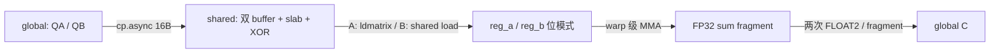

# 第 9 章 Tensor Core：从 SIMT 外积到 warp 级矩阵指令

[上一章](08-用K30串起整个项目.md) · [目录](README.md) · [两轮优化实战](../32-RTX4090D-TensorCore优化学习指南.md)

前八章用 K10/K30 学习严格 FP32 的 SIMT 微内核。本章沿用“谁搬运、谁拥有输出、何时可以读取”的分析方法，进入 RTX 4090 D 上实际运行的 Tensor Core 实现。新的计算指令没有替我们解决访存、同步和资源分配问题，输入精度还多了一份需要明确的约定。

本章以已经完成的原生 CUDA 实验为教材，不新增 GPU 测量。代码来源为 QiLHong / vitamin-cuda 提交 `520f97093a2abc239977be83d244b327d0e2e2ef`，原函数 `sgemm_tf32_swizzle_bcf_dbf_kernel`；[来源清单](../../../experiments/tensorcore/vendor/provenance.json)和[许可证](../../../experiments/tensorcore/vendor/LICENSE)保留。BN64 是本仓库的派生优化，完整差异见 [device.diff](../../../experiments/tensorcore-bn64/device.diff)。

## 1 先把一条标量 FMA 换成一个矩阵问题

K30 的核心可以从一条标量更新理解：

```cpp
// 示意：寄存器中保存一个 A 值、一个 B 值和一个输出累加值。
acc = a * b + acc;
```

多个线程各有若干 `acc`，循环组织成许多外积。BN64 文件中的 `M16N8K8` 则把一个 warp 的寄存器合起来，完成 `D = A×B + C` 的矩阵更新：

```text
A: 16×8        B: 8×8        C、D: 16×8
每个输出对 8 个 K 元素累加
一次完整 warp 操作：16×8×8 = 1024 次乘加，按 2 FLOP/乘加计为 2048 FLOP
```

这不是“每个线程各做 2048 FLOP 的独立矩阵乘”。32 个 lane 共同持有 operand 和结果：每个 lane 的四个 FP32 累加值，合起来是 `32×4=128` 个输出。`m16n8k8` 描述本次矩阵操作的 M/N/K 形状，不是 blockDim，也不是整个 CTA 的 tile。

在 [BN64 kernel](../../../experiments/tensorcore-bn64/tf32_bn64.cuh) 中，搜索 `M16N8K8` 可见 PTX 使用 `f32.tf32.tf32.f32` 类型序列，表示 D 为 FP32、A/B 为 TF32、C 为 FP32。输出坐标公式与该指令的 fragment 约定匹配。官方的 warp fragment 定义见 [PTX 8.4：mma.m16n8k8](https://docs.nvidia.com/cuda/archive/12.4.1/parallel-thread-execution/index.html#warp-level-matrix-fragment-mma-1688)。

Tensor Core 乘法的输入精度已经改变。即使结果与累加器都是 `float`，也不能据此宣称计算等价于 K30 的原始 FP32 乘法。

## 2 CUDA C++、WMMA、PTX、SASS 是不同层次

| 你看到的东西 | 应当回答的问题 | 本项目的对应位置 |
|---|---|---|
| CUDA C++ host/launch | 输入怎样准备，模板参数和 grid 是什么？ | `benchmark.cu` 的 `prepareInputs`、`Data::launch` |
| C++ WMMA API | 是否通过 `fragment`、`mma_sync` 等接口表达 warp 操作？ | 本实验未用 WMMA API 编写乘加主循环 |
| 内联 PTX | 精确使用哪种矩阵指令、operand 类型与寄存器接口？ | `M16N8K8`、`LDMATRIX_X4`、`CP_ASYNC_CG` |
| SASS | sm_89 最终生成哪些机器指令，实际排列怎样？ | 归档 `binary.sass` 与主循环摘录 |

本项目调用 `nvcuda::wmma::__float_to_tf32` 转换输入，不表示乘加主循环也使用 WMMA API。主循环的操作由内联 PTX 表达；已保存的机器码中可以找到 `HMMA` 和 `LDGSTS`。

WMMA 的 C++ `fragment` 内部元素到 lane 的映射不承诺为固定布局。不能把下面用于本核 PTX 的索引公式直接套在任意 `wmma::fragment.x[i]` 上。需要用 WMMA 访问有行列含义的结果时，应按接口存回矩阵再索引。见 [CUDA 12.4.1：Warp Matrix Functions](https://docs.nvidia.com/cuda/archive/12.4.1/cuda-c-programming-guide/index.html#wmma)。

本轮源码中的 MMA 排列，也不等于最终 SASS 保持完全相同的指令顺序。是否发出了 Tensor Core 指令、copy 与计算是否交错，应核对编译后的证据；“源码提前写了预取”本身不够。

## 3 精度是一条完整链，不能只看输出类型

先分开三个问题：输入保存了多少信息、乘加采用什么类型、最终结果怎样存储。

| 路线 | 输入准备与存储 | 累加 | 本项目输出 | 本轮状态 |
|---|---|---|---|---|
| K30 strict FP32 | 原始 float A/B | FP32 SIMT | FP32 | 已有独立严格对照 |
| TF32 Tensor Core | 从 float 显式量化，仍由 float 存储位模式 | FP32 | FP32 | 已测原版与 BK32/BN64 |
| FP16 Tensor Core | 转为 half，每元素 2 字节 | FP32 | FP16 | 第 28/29 章已测 |
| BF16 Tensor Core | bfloat16，每元素 2 字节 | 取决于具体指令；上游候选含 FP32 累加路径 | 取决于实例化 | 当前归档没有 BF16 实测成绩 |

FP16 的存储包括 5 位指数与 10 位尾数字段；BF16 为 8 位指数与 7 位尾数字段。BF16 的指数范围与 FP32 相同，但同一数量级内表示的数更稀疏。格式定义可查 [CUDA Math API：half](https://docs.nvidia.com/cuda/archive/12.4.1/cuda-math-api/struct____half.html) 与 [bfloat16](https://docs.nvidia.com/cuda/archive/12.4.1/cuda-math-api/struct____nv__bfloat16.html)。它们不能只按“都占 16 位”视为同一种输入。

TF32 保留 FP32 的指数范围而降低有效尾数精度。CUDA 的 `__float_to_tf32` 接收和返回 `float`，但返回的数值精度已变；TF32 的内部布局不应被当成跨架构固定存储格式。见 [CUDA 12.4.1：Alternate Floating Point](https://docs.nvidia.com/cuda/archive/12.4.1/cuda-c-programming-guide/index.html#alternate-floating-point)。

### 3.1 从真实 host 代码追踪一次转换

打开 [Tensor Core benchmark](../../../experiments/tensorcore/benchmark.cu)，搜索 `prepareInputs`：

```cpp
// 从原文件摘取输入准备的核心表达式。
tf[i] = nvcuda::wmma::__float_to_tf32(x[i]);
half h = __float2half_rn(x[i]);
fp16[i] = h;
fp16AsFloat[i] = __half2float(h);
```

`fp16AsFloat` 是为了建立已表示输入的参考，不是恢复丢失的低位。设量化后的矩阵为 `QA/QB`：

```text
原始问题：A × B
实际 Tensor 输入问题：QA × QB
对 QA/QB 用 CPU double 或 PEDANTIC FP32 计算：检查已量化输入下的运算差异
将 Tensor 输出与原始 A/B 参考比较：检查量化和运算共同造成的总误差
```

FP32 累加只能保留已送入累加过程的信息，无法找回输入量化丢掉的部分。FP16 输出还多一次最终舍入。现有 native benchmark 将输入转换放在计时外，所以主性能表也不包含这段转换的端到端成本。

### 3.2 为什么“与 cuBLAS 一样”仍可能失败

如果作者 kernel 和 TF32 cuBLAS 使用相同的 `QA/QB`，二者可以逐位一致，同时都与原始 `A×B` 相差超过 0.01。本项目正保留了这种结果。应该分别报告同精度一致性、原始 FP32 误差、NaN/Inf 与实际检查范围，不能把一个 PASS 代替其他标准。

具体阈值方向、全量与抽样范围见[第 32 章精度说明](../32-RTX4090D-TensorCore优化学习指南.md#328-正确性通过到哪一层)。TF32/FP16 性能与 strict FP32 是分组对照，BF16 目前只有代码路径，不能写入实测表。

## 4 从一个 MMA fragment 铺出整个 BN64 CTA

现在只看 [tf32_bn64.cuh](../../../experiments/tensorcore-bn64/tf32_bn64.cuh) 的真实参数：`BM=128, BN=64, BK=32`，256 线程，即 8 个 warp。warp 排列为 2×4，所以每个 warp 负责 64×16 输出。

本核 `sum[4][2][4]` 中，第一维 `mi` 选择四块 16 行，第二维 `ni` 选择两块 8 列，最后一维 `r` 是当前 lane 在每个 16×8 fragment 中拥有的四个输出。它不是一个连续的 4×2×4 三维矩阵。

```text
warp = tid / 32          lane = tid % 32
mi = 0..3               ni = 0..1               r = 0..3

row = by*128 + (warp/4)*64 + mi*16 + lane/4 + (r/2)*8
col = bx*64  + (warp%4)*16 + ni*8  + (lane%4)*2 + r%2
```

所有除法均为整数除法；`bx/by` 是 grid swizzle 后的逻辑 CTA 位置。在 warp 0、`mi=ni=0` 时：

| lane | 四个 CTA 内输出坐标 |
|---:|---|
| 0 | (0,0)、(0,1)、(8,0)、(8,1) |
| 1 | (0,2)、(0,3)、(8,2)、(8,3) |
| 2 | (0,4)、(0,5)、(8,4)、(8,5) |
| 31 | (7,6)、(7,7)、(15,6)、(15,7) |

手算 lane 31：`31/4=7`，`31%4=3`，前两个值落在第 7 行、第 6/7 列；后两个值行号再加 8。改变 `mi` 就加 16 行，改变 `ni` 就加 8 列。

一个线程保存 `4×2×4=32` 个输出。整个 CTA 有 `256×32=8192` 个输出，正好等于 `128×64`。但数量相等不排除“某处重复，另处遗漏”，所以[映射脚本](../../../scripts/analyze_tensor_bn64_mapping.py)枚举了全部坐标并检查每个只出现一次。

这也解释了 BN128 改 BN64 时为什么要同时改 warp 的 N 跨度、`ni` 上界和写回公式。只减少 shared 或 launch grid，不改变 fragment，就无法得到正确的新输出归属。

## 5 搬运者不是唯一消费者

`copy_tile(slot, kk)` 每次准备 BK32。它分为两个 16 宽的 K slab，保留旧版每个 slab 的布局：

```text
As[2 buffers][2 slabs][128 rows][16 columns]
Bs[2 buffers][2 slabs][16 rows ][64 columns]
```

一个线程每个 slab 搬两包 A、一包 B，每包 16 字节。逻辑搬运坐标与上节输出归属不同：

```text
A：row = tid/4 或 tid/4+64
   Kcol = kk + slab*16 + (tid%4)*4 + e
B：Krow = kk + slab*16 + tid/16
   col = (tid%16)*4 + e
e = 0..3；最后加上 CTA 的 M/N 全局基址
```

例如 tid 31 搬运的 A 行是 7 和 71，而它在 warp 0 的输出行还包含 15、23、31、39、47、55、63。它必须读取别的线程合作搬来的数据，不能只在自己的复制完成后就任意开算。

写入 shared 时再对列号做 XOR，读取时使用同一规则恢复逻辑关系。swizzle 改变物理地址分布，不改变矩阵数学值，也没有把 A/B 在全局内存中整体转置。



A 的 `ldmatrix.x4.b16` 搬运的是该实现的 float 位模式，后面送进 TF32 MMA。不能把 `.b16` 理解为“先做一次 FP16 数值转换”。B 通过 shared load 和 `__float_as_uint` 送入 operand 寄存器，后者也只是重解释位模式。

CPU 脚本检查 shared-to-register 的逻辑包覆盖，但没有完整模拟 `ldmatrix` 的硬件寄存器重排。GPU 的全量逐位结果是另一层证据，两者都不能代替未执行的 Sanitizer。

## 6 `sync`、wait 与 CTA barrier 各管哪一层

本核的同步流程可以按“新数据可读”和“旧槽可覆盖”两件事理解：

```text
序言：copy(tile0 -> slot0) -> commit -> wait_group 0 -> __syncthreads

主循环：
    copy(next tile -> write slot)
    commit
    compute(current tile in read slot)
    wait_group 0
    __syncthreads
    swap(read slot, write slot)

尾部：计算最后一个已加载 tile，随后直接写回 C。
```

`commit` 将当前线程的复制组成一组；`wait_group 0` 等它先前提交的复制组完成。这里的 CTA barrier 再协调跨线程消费，并使下一轮覆盖旧 read slot 前，其他 warp 也已完成当前 tile 的 shared 读取。异步复制的完成规则见 [PTX 8.4：cp.async wait](https://docs.nvidia.com/cuda/archive/12.4.1/parallel-thread-execution/index.html#data-movement-and-conversion-instructions-cp-async-wait-group-cp-async-wait-all)。

`mma.sync` 的名字也不是“整个 block 已完成所有 shared 读写”的证明。它对应 warp 协作的矩阵操作；不能用它替代这个八 warp CTA 的生产/消费 barrier，也不能只让拥有一个输出的 lane 单独执行该矩阵操作。

双缓冲的作用，是让下一 tile 写入不同于当前读取的地址。它创造交错的机会，没有保证延迟已全部隐藏。第 31 章的 SASS 确实保留了 copy/HMMA 交错，但公平计时仍显示 4096 的 BN64 没有稳定快于作者原版。不要把“有流水结构”直接翻译成“必然更快”。

## 7 寄存器里的输出怎样回到 C

在 `Write back C` 部分，`r=0,1` 是相邻两列，`r=2,3` 是相同两列、向下 8 行。代码因此每个 fragment 做两次 `FLOAT2` 写回：

```text
sum[mi][ni][0:2] -> C[row,   col:col+2]
sum[mi][ni][2:4] -> C[row+8, col:col+2]
```

BN64 路径的 C 是 FP32，没有单独 epilogue kernel；但作者 FP16 路线不同：`sum` 仍是 float，最终转为 half 后写回，带 RW 的版本还经过 shared 重排。这些属于实际代码差异，不能把两个版本的吞吐差全算作“Tensor Core 精度不同”。

本轮 Tensor kernel 只实现 `C=AB`。把 host 的 `alpha/beta` 改成其他值，不会自动让未实现的 epilogue 生效。统一入口也没有尾块保护：M 为 128 的整数倍、N 为 1024 的整数倍、K 为 32 的整数倍，且分别限制在已验证范围内，详见[复跑约束](../32-RTX4090D-TensorCore优化学习指南.md#329-按目的选择复跑命令)。

## 8 Ada 上要看实际资源，而不是套用别的架构教程

本机目标是 `sm_89`。Ada 的 shared 分配与寄存器限制仍会影响驻留；设备支持 Tensor Core，不等于任意大 tile 都能同时驻留足够多 CTA。该架构的 shared/occupancy 约束见 [CUDA 12.4.1 Ada Tuning Guide](https://docs.nvidia.com/cuda/archive/12.4.1/ada-tuning-guide/index.html#occupancy)。

本项目实测资源为：

| 实现 | registers/thread | 用户 shared/CTA | 理论 CTA/SM |
|---|---:|---:|---:|
| 作者 TF32 BK16 | 127 | 32 KiB | 2 |
| BN128/BK32 | 170 | 64 KiB | 1 |
| BN64/BK32 | 102 | 48 KiB | 2 |

这些值来自本机 ptxas/NCU 与 occupancy 查询，不能只用 `sum` 数组元素个数替代实际寄存器统计。[第 30 章](../30-TensorCore-K分块实验与资源代价.md)说明了 BK32 的回退，[第 31 章](../31-TensorCore-BN64优化与尺寸效应.md)说明了 BN64 的尺寸效应。TF32 的 Tensor 管线与 strict FP32 的 FMA 管线指标要分开解释。

本章使用 warp 级 `mma.sync`、`ldmatrix` 与普通 `cp.async`。不要把 Hopper 教程中的 TMA / `wgmma` 直接搬进本机 sm_89 入口：PTX 8.4 将 bulk tensor copy 列在 sm_90 及以上，并将加速 `wgmma` 列为 sm_90a 能力，见 [PTX target 特性表](https://docs.nvidia.com/cuda/archive/12.4.1/parallel-thread-execution/index.html#ptx-module-directives-target)。本轮也没有执行 sparse、FP8 或 BF16 实验。

## 9 不开 GPU，复核一次输出映射

在普通 PowerShell 的仓库根目录运行，使用已有 Python；新输出目录不能与旧归档重名：

```powershell
Set-Location 'D:\CUDA-Lab\cuda-learning\SGEMM_CUDA'
$py = 'D:\Anaconda\Anaconda\python.exe'
$out = 'results\windows\tensorcore-mapping-learning-' + (Get-Date -Format 'yyyyMMdd-HHmmss')
& $py scripts\analyze_tensor_bn64_mapping.py --output $out
if ($LASTEXITCODE) { throw 'mapping failed' }
```

预期摘要包含：8192 个输出、每线程 32 个输出、12288 个 shared float 搬运地址；重复、遗漏、越界均为零。打开 `output-fragments.csv`，过滤 `warp=0,lane=31`，会得到 32 行，而不是本章小表中的四行；小表只固定了 `mi=ni=0`。

旧 [check_microbook_examples.py](../../../scripts/check_microbook_examples.py)继续检查前八章的 SIMT 例子；它不负责验证本章 Tensor Core 指令语义。需要 GPU 正确性、计时与 NCU 时，使用[第 32 章完整命令](../32-RTX4090D-TensorCore优化学习指南.md#329-按目的选择复跑命令)，不要把 CPU 映射 PASS 当成已执行 GPU 检查。

## 10 三道练习

1. 本核一次 warp 级 `m16n8k8` 计多少 FLOP？为什么不能再乘 32？BN64 中每线程又为何有 32 个输出？
2. 取 warp 1、lane 2、`mi=2,ni=1`，手算四个 CTA 内输出坐标，再说明这四个值是否就是该线程搬运的 A/B 的独立乘积。
3. 两个 TF32 实现逐位相同且快于 TF32 cuBLAS，但相对原始 FP32 的 max abs 为 0.5。应该如何写结论？若删除 CTA barrier 后某次结果仍相同，能宣布同步冗余吗？

### 参考答案

1. `2×16×8×8=2048 FLOP`，是整个 warp 协作完成的工作。32 个 lane 各保存四个结果，已经包含在这次矩阵操作里。BN64 每 lane 有四个 M fragment、两个 N fragment，每个四值，所以为 32 个输出。
2. 行为 32/40，列为 28/29，即 (32,28)、(32,29)、(40,28)、(40,29)。它们沿完整 K 累加，并消费整个 CTA 合作搬入的数据；该线程的搬运职责不能当作独立输入集合。
3. 应写“在这些尺寸、输入和事件计时条件下，同 TF32 精度的实现间一致，并观察到相对 TF32 cuBLAS 的性能优势；原始 FP32 精度标准失败”。一次未观察到错误不能证明没有竞争；必须先解释跨 warp 的读写依赖，再做完整验证，不能凭一个输出删同步。

读完后返回[第 32 章](../32-RTX4090D-TensorCore优化学习指南.md)，把本章的指令、fragment 和同步概念用于解释 BK32/BN64 的真实收益与反例。记住自己此时得到的是源码理解与证据阅读能力，新的性能结论仍需要新的公平测量。

[上一章](08-用K30串起整个项目.md) · [目录](README.md)
